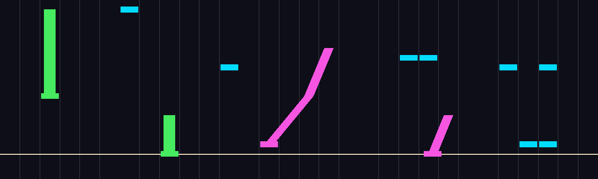

# RhythmBot — simulation pipeline

A simulated KUKA iiwa (with the course's Schunk WSG gripper) playing a
Project SEKAI–style rhythm game in Drake: **tap**, **hold** and **slide**
notes on a touch surface, with the notes delivered to the robot by a
perception stage that a trained vision model will eventually fill.

The design borrows from [GuitarHeroBot](https://github.com/JRed46/GuitarHeroBot)
(6.4210, Fall 2023): a `MakeHardwareStation` iiwa+WSG scene, notes written as
`(lane, start, duration)`, pre-press / press / post-press gripper keyframes
joined by a linear `PiecewisePose`, differential IK into the station's
position port, and a color-segmentation perception pipeline. What is new is
everything the proposal asks for beyond button presses: continuous slides,
holds, a closed-loop perception→plan→control loop that replans as notes come
into view, a touch judge with the game's timing windows, and a pluggable
policy interface for the LLM / behavior-cloning comparisons.

```
chart.json ──► GameScreen ───frame───► RhythmBrain ──X_WG_desired──► DiffIK ──q──► HardwareStation
                 (2D render)            │ NoteDetector                                 │ body_poses
                                        │ tracker + Policy (ClassicalPlanner)          ▼
HighwayVisualizer (3D notes in Meshcat) │                                         TouchSensor ──► Judge ──► report.json
```



*What the perception stage sees (`FrameRenderer`), at five moments of the
demo chart: cyan taps, a green hold (second frame: active, head pinned to
the judgment line), magenta slides (fourth frame: active, clipped at the
line), and two-note chords.*

## Running

Everything runs from the repository root. In the course folder the course
venv already has every dependency:

```bash
cd ~/mit/64210/project
../.venv/bin/python -m rhythmbot.play --demo --hold
```

In a fresh clone, make a Python 3.13 environment from `requirements.txt`
(torch is only needed for the vision model):

```bash
uv venv --python 3.13 && uv pip install -r requirements.txt
.venv/bin/python -m rhythmbot.play --demo --hold
```

The trained vision model and the result reports are committed under
`results/`. The training frames (`data/`) are not; regenerate them with
`rhythmbot.dataset` before retraining.

Open the Meshcat URL it prints. `--hold` keeps the server up after the song
so the recording can be scrubbed (`Open Controls → Animations`).

| command | what it does |
|---|---|
| `HEADLESS=1 python -m rhythmbot.play --demo` | no browser, fastest; prints and saves the score report |
| `python -m rhythmbot.play --chart charts/random-1.json --detector color` | play a chart file using the image-based detector |
| `python -m rhythmbot.play --random 7 --noise 0.03 --latency 0.15` | random chart, oracle detector with timing jitter and detection delay |
| `python -m rhythmbot.play --demo --audio --hold` | with a soundtrack synthesized from the chart (needs `afplay`, i.e. macOS, or `aplay`/`ffplay`) |
| `python -m rhythmbot.play --detector torch --model results/note_detector.pt` | play from the trained vision model |
| `python -m rhythmbot.dataset --out data/train --charts 60 --fps 10` | render labelled game frames for training |
| `python -m rhythmbot.dataset --out data/preview --preview` | one contact sheet of frames to eyeball the rendering |
| `python -m rhythmbot.train --epochs 24` | train the note detector on `data/train`, validate on `data/val`, export `results/note_detector.pt` |
| `python -m rhythmbot.train --eval-only --model results/note_detector.pt` | detector metrics on the validation frames |
| `python -m rhythmbot.importers song.osu --out charts/` | import a real chart (osu!mania `.osu`, StepMania `.sm`/`.ssc`, Clone Hero `.chart`) |
| `python -m rhythmbot.importers --guitarherobot --out charts/` | GuitarHeroBot's hand-transcribed *Slow Ride* charts (easy/medium/hard) |
| `python -m rhythmbot.play --chart charts/song.json --song song.mp3 --tempo 0.6` | play an imported chart with its song, both slowed to 60 % |

Reports land in `results/<chart>-<detector>.json`.

## Results (classical planner, three perception stages)

All headless, default config. Completion counts a note only if it was hit
on time *and*, for holds and slides, contact was kept for ≥80 % of it.
The oracle and the color-segmentation detector complete every note of
every chart below with every note judged "perfect" (timing error within
±10 ms), so the table shows the trained vision model against that ceiling.

| chart | notes | vision model: completion | judgments (perfect/great/good/miss) | timing error mean ± std |
|---|---|---|---|---|
| demo | 18 | 100% | 18/0/0/0 | −6 ± 16 ms |
| random-1 | 15 | 100% | 15/0/0/0 | +3 ± 5 ms |
| random-2 | 21 | 100% | 21/0/0/0 | +2 ± 9 ms |
| random-3 | 19 | 100% | 19/0/0/0 | +6 ± 10 ms |
| slow-ride-easy (Guitar Hero III) | 14 | 100% | 13/1/0/0 | +9 ± 27 ms |
| slow-ride-medium | 18 | 100% | 15/3/0/0 | +14 ± 26 ms |
| slow-ride-hard | 33 | 100% | 26/5/2/0 | +12 ± 35 ms |
| **all** | **138** | **100%** | **127/9/2/0** | |

Holds keep contact for their whole length, including the 7 s sustain that
ends every Slow Ride chart; slides keep contact for 92–100 % of their
length with 6–11 mm RMS lateral error (lane width 50 mm).

What still separates the vision model from the oracle is timing spread on
the real song: its timing error std is 26–35 ms on Slow Ride against
5–16 ms on the other charts, so 11 Slow Ride notes are judged "great" or
"good" rather than "perfect". Slow Ride repeats notes in one lane every
0.2–0.3 s, where several heads crowd the bottom of the frame at once.
These seven charts are also a small test set; more imported songs would
make the comparison firmer.

**How it got here.** The first model, with two slots per lane and trained
on narrower random charts, completed 15 of 18 notes on Slow Ride Medium.
Each row below is all seven charts, with every change kept from the rows
above it.

| step | completed |
|---|---|
| training charts widened to real-chart statistics, 3 slots, log-scaled duration, 24 epochs | 133 / 138 |
| planner re-decides skipped notes on every replan | 134 |
| active slot (note being played, time to its end) | 135 |
| tracker drops upcoming notes unreported for 0.2 s | **138** |

The last three rows are fixes found by running the model in the loop. A
note skipped early on a wrong belief (say, a previous hold's duration
briefly overestimated) used to stay skipped for good. The active slot fixed
the long holds. And on Slow Ride's runs of same-lane notes the model
sometimes flips a note between tap and hold from frame to frame, which left
a phantom duplicate that held the finger down through the next real note.
The previous model is kept as `results/note_detector_v4.pt`.

Vision model on 2431 held-out validation frames (`train.py --eval-only`):
upcoming notes precision 1.000 / recall 1.000, kind accuracy 0.997,
time-to-hit MAE 20 ms, path-lane MAE 0.18 lanes, duration MAE 0.39 s
(guessed before the hit, often with the tail off-screen); notes being
played precision 0.998 / recall 0.997, end-time MAE 15 ms once the end is
in view, and every off-screen end correctly reported as off-screen.

Noisy-oracle check: with 30 ms hit-time jitter and 150 ms detection
latency the oracle still completes 18/18 on the demo.

## Importing real songs

`rhythmbot/importers.py` reads the chart formats of three popular rhythm
games and writes our JSON:

| format | game | what maps |
|---|---|---|
| `.osu` (Mode 3) | osu!mania | columns → lanes, circles → taps, mania holds → holds, first timing point → BPM, `AudioFilename` → `Chart.audio` |
| `.sm` / `.ssc` | StepMania, In The Groove | 4 panels → centre lanes, beats → seconds through `#BPMS`/`#STOPS`/`#OFFSET`, holds and rolls → holds, `#MUSIC` → audio |
| `.chart` | Clone Hero / Guitar Hero (Moonscraper) | 5 frets → lanes 0–4, ticks → seconds through `[SyncTrack]`, sustains → holds, `MusicStream` → audio |
| notebook tuples | GuitarHeroBot's *Slow Ride* | buttons → lanes, `13` chords → two taps, sustains → holds |

None of these games has slides, so imported charts contain taps and holds
only. Game columns beyond six are spread across the lanes
(`importers.map_columns`). What is **not** imported is the music itself:
beatmaps and song packs are copyrighted, so point `play --song` at an audio
file you own (or the chart's own `audio` entry, resolved relative to the
chart file). Real charts are usually denser than one fingertip can play, so
`--tempo 0.6` slows chart and song together (`afplay -r`), and
`importers --min-gap 0.25` thins notes that follow another too closely.

The *Slow Ride* charts are in `charts/slow-ride-*.json`; they are the
numbers GuitarHeroBot's authors typed into their notebook, so they play
without any song file (silently, or with `--audio` for the synthesized
track).

## Playing a real osu!mania beatmap

The first real chart played end to end is a ranked osu!mania map:
*NekoTeto feat. Kasane Teto SV* by d0tc0mmie (an osu! Featured Artist,
so the music is licensed to osu!), difficulty "[4K] Easy Neko" by
RhythmHomura, beatmap 5711487, 1.1 stars. Only the chart text was
fetched, from the official site's public `osu.ppy.sh/osu/<beatmap id>`;
the song audio was not downloaded, so live runs use `--audio`. To
reproduce:

```bash
mkdir -p songs/nekoteto && curl -sSL -o songs/nekoteto/easy-neko.osu https://osu.ppy.sh/osu/5711487
python -m rhythmbot.importers songs/nekoteto/easy-neko.osu --out songs/nekoteto/easy-neko.json
python -m rhythmbot.play --chart songs/nekoteto/easy-neko.json --detector torch --model results/note_detector.pt --audio --hold
```

`songs/` is gitignored. If you download the full beatmap from osu! and put
its `audio.mp3` next to the `.osu`, `play` uses the real song
automatically, delayed by the importer's lead-in (`--lead-in`, default
2.5 s, since the map's first note is at 0 s). Measured against the decoded
`audio.mp3` (spectral-flux onsets, low band and full spectrum agreeing),
the music's beats land about 80 ms after the chart's note times, so the
imported chart starts this song 80 ms early (`audio_offset` 2.42 s). If a
live run still sounds off, adjust by ear with `play --song-offset`.

The map has 244 notes (200 taps, 44 holds) over 96 s on four lanes,
with 20 two-note chords and notes never closer than 0.29 s.

| detector | completed | judgments (perfect/great/good/miss) | timing error mean ± std |
|---|---|---|---|
| oracle | 243 / 244 (99.6 %) | 243/0/0/1 | +8 ± 3 ms |
| color segmentation | 243 / 244 (99.6 %) | 243/0/0/1 | +7 ± 3 ms |
| vision model | 240 / 244 (98.4 %) | 239/0/1/4 | +5 ± 10 ms |

osu!mania assumes independent fingers: hold one key, tap others. The
WSG's two fingertips move up and down together, so at first, while one
pressed a hold, the other could not tap. The robot then completed 220 / 244
with the oracle and color detectors and 218 with the vision model. 21 of
the 24 oracle misses were notes starting while a hold in another lane was
still down, on this map usually at the moment the hold ends.

**Rolling about the hold finger.** The planner now keeps a hold with one
fingertip and plays the notes around it with the other. The WSG opens so
the free fingertip is over the next note's lane, and the hand rolls about
world y through the holding fingertip: the free fingertip waits 10 mm above
it, dips to the screen for the note and rises again. When the free
fingertip lands a hold that outlasts the first, the two swap roles: the
new hold finger becomes the pivot and the old one lifts. Keyframes say
which point they place (`Keyframe.ref`: the midpoint or one fingertip) and
how far one fingertip is above the other (`Keyframe.rise`), and `Plan`
interpolates each segment about its reference point, so the holding
fingertip stays put while the hand rolls and reopens. A hold's fingertip,
position and opening are fixed once it is down (`TrackedNote.held`), so
replans keep it where it landed. Lanes 1 and 4 are 15 cm apart, more than
the WSG's 13 cm, so two fingertips may each land up to 12 mm off their
lane centres (lanes are 50 mm wide); that also makes the two 1+4 chords
playable.

In the oracle run, rolls stay under 15°, the arm stays at least 0.31 rad
from every joint limit, and a holding fingertip slides at most 10 mm
within its lane during a hold (6 mm at the 90th percentile; 7.5 and 4 mm
before rolling) and stays within 12.5 mm of the lane centre. The slide
comes from the station's arm controller lagging the command by roughly
40 ms during the quickest rolls. Reopening the WSG about a holding
fingertip swings the whole gripper sideways, so it is capped at 1 m/s
(`Motion.pivot_width_speed`). The regression charts above still score
100 % with the oracle and color detectors, and the noisy oracle (30 ms
jitter, 150 ms latency) also completes 243 / 244 here.

The one note the oracle run misses, #125, is a lane-4 tap at the moment a
lane-1 hold ends and a lane-3 hold starts: three lanes at once. The color
detector run keeps that tap and drops the hold instead. Against the
color detector, the vision model also loses two taps (#151, #154) and the
hold #136.

### Harder difficulties of the same song

The full beatmap download (`songs/nekoteto/`, from the official osu! page;
gitignored) has four harder 4K difficulties of the same song, imported the
same way with the same 80 ms song offset. Results with the gripper-roll
planner:

| difficulty | stars | notes | notes/s | oracle completion | vision model completion |
|---|---|---|---|---|---|
| Easy Neko | 1.10 | 244 | 2.5 | 99.6 % | 98.4 % |
| Normal Neko | 1.64 | 446 | 4.7 | 80.9 % | 66.6 % |
| Advanced Neko | 2.49 | 759 | 7.9 | 64.7 % | 50.1 % |
| Llee's Hard Neko | 2.88 | 907 | 9.5 | 56.8 % | 53.4 % |
| Nyanyannyanyan | 3.85 | 1206 | 12.6 | 44.1 % | 42.1 % |

With perfect perception, almost every miss is a physical limit of one arm
with a two-finger gripper:

| why the oracle run missed a note | Normal | Advanced | Hard | Nyan |
|---|---|---|---|---|
| lane change needed in under 0.15 s | 68 | 80 | 191 | 204 |
| 3 or more lanes at once (2 fingertips) | 0 | 141 | 115 | 381 |
| two lanes wider apart than the gripper opens | 7 | 16 | 30 | 25 |
| hit, but hold let go early | 3 | 21 | 32 | 53 |
| same-lane repeat or other timing | 7 | 10 | 24 | 11 |

The vision model's extra losses on these maps are a perception limit on top
of that: up to 8 notes queue in one lane on screen at once against the
model's 3 slots per lane, and its training charts never put notes closer
than 0.18 s, while these go down to 0.04 s, less than the drawn thickness
of one note. Reports are in `results/neko-<difficulty>-<detector>.json`.

## Modules

| file | role |
|---|---|
| `rhythmbot/config.py` | every tunable: lane geometry and frame conventions, judgment windows, gripper offsets, planner shape, perception rate |
| `rhythmbot/chart.py` | `Note`/`Chart`, JSON load/save, `random_chart` generator, built-in demo |
| `rhythmbot/game.py` | `FrameRenderer` (2D game screen → `uint8` image + pixel labels) and `HighwayVisualizer` (same notes as moving Meshcat geometry) |
| `rhythmbot/perception.py` | `NoteDetector` interface; `OracleDetector`, `ColorSegmentationDetector`, `TorchDetector` |
| `rhythmbot/planner.py` | `Policy` interface and `ClassicalPlanner` (keyframes → fingertip pose, rolled about a holding fingertip when needed, + gripper width) |
| `rhythmbot/brain.py` | `GameScreen` and `RhythmBrain` LeafSystems: perception tick, note tracking, replanning, pose output |
| `rhythmbot/robot.py` | scene YAML/SDF, hardware station, DiffIK integrator, start-pose IK, `TouchSensor` |
| `rhythmbot/judge.py` | timing/contact scoring and the JSON report |
| `rhythmbot/play.py` | builds the diagram, runs, reports |
| `rhythmbot/dataset.py` | labelled frame generation for the vision model |
| `rhythmbot/train.py` | the vision model (`NoteNet`), its training loop, validation metrics and TorchScript export |
| `rhythmbot/audio.py` | soundtrack synthesized from the chart, or a song file, played in sync with a live run |
| `rhythmbot/importers.py` | osu!mania, StepMania and Clone Hero chart importers; GuitarHeroBot's Slow Ride |
| `charts/` | demo and three random charts |

## How the pieces work

**Scene.** The iiwa base is at the world origin; the course's default joint
angles point the arm along −y, so the touch screen is laid in front of it
there. Lanes run along world x (lane 0 at −x), notes travel toward the robot
along +y and are hit at the judgment line `y = −0.50`. The screen slab is
visual-only: a position-controlled arm pressing into a rigid welded box only
fights the contact solver, and a touchscreen does not push back. Touch is
sensed geometrically from the station's `body_poses`: a fingertip is "down"
when it is within 4 mm above the screen plane. Fingertip points were measured
off the WSG model (finger frames 77 mm out along the gripper's y, finger
meshes 41 mm beyond that; fingers slide along the gripper's x).

**Perception.** `GameScreen` renders what a player would see, at the
perception tick (30 Hz) and only if the detector asks for pixels. The
`ColorSegmentationDetector` is GuitarHeroBot's HSV trick in numpy/scipy:
mask each note color, label connected blobs, bottom edge → hit time, centre
→ lane, top edge → end, centre column per row → slide path. A note already
being played has its head pinned on the judgment line (as in the game) and
is reported with `active=True`, so the tracker refines only its end time.
`TorchDetector` runs the trained model described next.

**Vision model (`train.py`).** `NoteNet` is a four-stage CNN whose feature
map is resampled to one column per lane and read by an MLP shared across
lanes. For each lane it predicts four slots:

* three **upcoming** slots, the three nearest note heads in that lane that
  have not reached the judgment line, each with a presence logit, a kind
  (tap/hold/slide), time to hit, duration, and the note's lane at
  25/50/75/100 % of its duration, which is the slide path;
* one **active** slot, the hold or slide being played in that lane right
  now (its head pinned on the line), with a presence logit, a kind
  (hold/slide) and the time left until it ends.

The active slot exists because of long holds. Before the hit, the end of a
hold longer than the 1.6 s approach time is above the top of the frame, so
its duration can only be guessed; it comes into view only while the hold is
being played. The brain treats an active report whose end is still
off-screen as a lower bound and keeps extending the hold, and once the end
is in view it replaces the earlier guess with the measured end, correcting
overestimates as well as underestimates. Slides get their predicted path
stretched to the corrected duration.

Input is the full 256×384 frame; the module downsamples by two inside
`forward`, so `TorchDetector` only normalises pixels to [0, 1]. Durations
are log-scaled so 0.15 s sustains and 7 s holds are both learnable.
Training data is `dataset.py` output from `chart.varied_random_chart`
(80 charts whose density, hold lengths, gaps and lane repetition are
themselves randomised to span real charts; 10 fps, ~16k frames; validation
on 12 unseen charts), 24 epochs, about 25 minutes on Apple MPS. The export
is TorchScript plus a JSON sidecar with the normalisation constants and
slot layout, which `TorchDetector` reads, so older models still load.

Several robustness rules in the brain and planner came out of running the
model in the loop:

* a note is planned for only after it has been seen in two frames
  (`Perception.min_observations`), because the model occasionally emits a
  one-frame phantom just as a head crosses the judgment line;
* an upcoming note unreported for 0.2 s is dropped
  (`Perception.stale_after`): real notes are on screen and reported for the
  whole 1.6 s approach, so a silent one is a phantom or a duplicate left by
  the model flipping a note's kind between frames;
* a note first seen only once it is already being played is ignored, since
  its hit is lost and chasing it would only spoil the next note;
* the planner re-decides which notes to skip on every replan, freezing the
  decision only once the hand has started descending toward a note, so a
  skip based on an early wrong belief is undone when perception corrects it.

**Brain.** One abstract state updated in a periodic event (Drake-clean): a
dict of `TrackedNote`s merged from detections (matched by chart id when the
oracle supplies one, else by kind + lane + hit-time proximity, averaging the
hit time across frames), pruned when finished, then handed to the `Policy`
with the *currently commanded* fingertip pose so every replan is continuous
with the previous plan.

**Classical planner.** Per note: hover above the lane at `hit − 0.22 s`,
cross the contact height exactly at the hit time, press 2 mm, stay for a
tap dwell / hold duration / slide waypoints, lift. Between notes the tip
waits above the last note and leaves just in time to arrive at the next
hover. Two simultaneous taps up to three lanes apart become a chord: the WSG
opens so that one fingertip lands in each lane (`Gripper.width_for_tip_gap`).
A note due while a hold is still down is played by the other fingertip,
rolling the hand about the holding one (see *Playing a real osu!mania
beatmap*). Notes that cannot be reached are skipped explicitly and
reported.

**Controller.** Drake's `DifferentialInverseKinematicsIntegrator` on an
arm-only plant (`MakeMultibodyPlant(..., add_frozen_child_instances=True)`
freezes the hand onto it so the `body` frame exists), with joint position
and velocity limits and nullspace centering on the start configuration. The
start configuration is solved with `InverseKinematics` so the arm begins
hovering over the middle of the judgment line.

**Judge.** At 200 Hz against the chart (ground truth, not the brain's
belief): taps need a *fresh* touch-down in the lane within ±140 ms (perfect
≤45, great ≤90, good ≤140); holds and slides additionally need contact for
≥80% of their duration, slides within 0.6 lanes of the moving target; slide
RMS lateral error is recorded. Both fingertips are eligible, which is what
lets chords score.

## Plugging in the other approaches from the proposal

* **Vision model** → `train.py` is the baseline; a different architecture
  only has to keep `TorchDetector.decode`'s output contract, or override
  `decode`. Harder perception (a real Drake camera looking at the Meshcat
  highway, visual clutter, a different game skin) means regenerating
  `dataset.py` frames from that source and retraining.
* **LLM direct control / code-as-policy, behavior cloning** → implement
  `Policy.plan(tracked_notes, t, X_WT_cmd, width_cmd) -> Plan` (or, for a
  lower-level policy, replace `RhythmBrain`'s output with your own pose
  stream). `ClassicalPlanner` doubles as the demonstration generator for
  behavior cloning; `judge.Judge` scores every approach identically.
* **Harder charts** → `random_chart` has density / hold / slide / chord
  probabilities; `Layout` has lane count and scroll speed.

## Known limits / next steps

* Two contact points that share one hand: two-finger chords, and one
  fingertip playing while the other holds. Three-note chords, chords that
  include a hold, and notes on the holding fingertip's own side are
  skipped.
* Touch is geometric, not physical. Switching to a compliant (hydroelastic)
  screen and the station's `contact_results` port would let contact force
  be a metric too; `TouchSensor` is the only place to change.
* The 2D frame is rendered from the chart, not from a Drake camera. An
  `RgbdSensor` looking at the Meshcat highway could replace `GameScreen`
  once the vision model should see the real scene.
* The soundtrack is synthesized from the chart (click track plus a tone per
  note). Playing a real song means authoring or importing a chart against
  its beat grid; `Chart.bpm` and note times are all that is needed.
* Replanning restarts from the commanded (not measured) pose; DiffIK
  tracking lag is small here (std of timing error ≈ 15 ms) but a measured-
  state feedback term would make it robust to saturation on fast charts.
