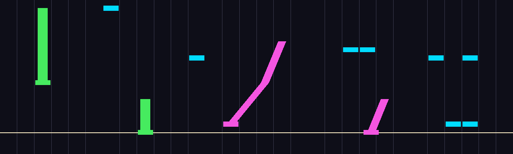

# RhythmBot — simulation pipeline

A simulated KUKA iiwa (with the course's Schunk WSG gripper) playing a
Project SEKAI–style rhythm game in Drake: **tap**, **hold** and **slide**
notes on a touch surface, with the notes delivered to the robot by a
perception stage that a trained vision model will eventually fill.

The design borrows from [GuitarHeroBot](https://github.com/JRed46/GuitarHeroBot)
(6.4210, Fall 2023): a `MakeHardwareStation` iiwa+WSG scene, notes written as
`(lane, start, duration)`, pre-press / press / post-press gripper keyframes
joined by a linear `PiecewisePose`, differential IK into the station's
position port, and a color-segmentation perception pipeline. What is new is
everything the proposal asks for beyond button presses: continuous slides,
holds, a closed-loop perception→plan→control loop that replans as notes come
into view, a touch judge with the game's timing windows, and a pluggable
policy interface for the LLM / behavior-cloning comparisons.

```
chart.json ──► GameScreen ───frame───► RhythmBrain ──X_WG_desired──► DiffIK ──q──► HardwareStation
                 (2D render)            │ NoteDetector                                 │ body_poses
                                        │ tracker + Policy (ClassicalPlanner)          ▼
HighwayVisualizer (3D notes in Meshcat) │                                         TouchSensor ──► Judge ──► report.json
```



*What the perception stage sees (`FrameRenderer`), at five moments of the
demo chart: cyan taps, a green hold (second frame: active, head pinned to
the judgment line), magenta slides (fourth frame: active, clipped at the
line), and two-note chords.*

## Running

Everything runs from the repository root. In the course folder the course
venv already has every dependency:

```bash
cd ~/mit/64210/project
../.venv/bin/python -m rhythmbot.play --demo --hold
```

In a fresh clone, make a Python 3.13 environment from `requirements.txt`
(torch is only needed for the vision model):

```bash
uv venv --python 3.13 && uv pip install -r requirements.txt
.venv/bin/python -m rhythmbot.play --demo --hold
```

The trained vision model and the result reports are committed under
`results/`. The training frames (`data/`) are not; regenerate them with
`rhythmbot.dataset` before retraining.

Open the Meshcat URL it prints. `--hold` keeps the server up after the song
so the recording can be scrubbed (`Open Controls → Animations`).

| command | what it does |
|---|---|
| `HEADLESS=1 python -m rhythmbot.play --demo` | no browser, fastest; prints and saves the score report |
| `python -m rhythmbot.play --chart charts/random-1.json --detector color` | play a chart file using the image-based detector |
| `python -m rhythmbot.play --random 7 --noise 0.03 --latency 0.15` | random chart, oracle detector with timing jitter and detection delay |
| `python -m rhythmbot.play --demo --audio --hold` | with a soundtrack synthesized from the chart (needs `afplay`, i.e. macOS, or `aplay`/`ffplay`) |
| `python -m rhythmbot.play --detector torch --model results/note_detector.pt` | play from the trained vision model |
| `python -m rhythmbot.dataset --out data/train --charts 80 --dense 80 --fps 10` | render labelled game frames for training (80 varied + 80 dense random charts) |
| `python -m rhythmbot.dataset --out data/preview --preview` | one contact sheet of frames to eyeball the rendering |
| `python -m rhythmbot.train --epochs 30` | train the note detector on `data/train`, validate on `data/val`, export `results/note_detector.pt` |
| `python -m rhythmbot.train --eval-only --model results/note_detector.pt` | detector metrics on the validation frames |
| `python -m rhythmbot.importers song.osu --out charts/` | import a real chart (osu!mania `.osu`, StepMania `.sm`/`.ssc`, Clone Hero `.chart`) |
| `python -m rhythmbot.importers --guitarherobot --out charts/` | GuitarHeroBot's hand-transcribed *Slow Ride* charts (easy/medium/hard) |
| `python -m rhythmbot.play --chart charts/song.json --song song.mp3 --tempo 0.6` | play an imported chart with its song, both slowed to 60 % |

Reports land in `results/<chart>-<detector>.json`.

## Results (classical planner, three perception stages)

All headless, default config. Completion counts a note only if it was hit
on time *and*, for holds and slides, contact was kept for ≥80 % of it.
The oracle and the color-segmentation detector complete every note of
every chart below with every note judged "perfect" (timing error within
±10 ms), so the table shows the trained vision model against that ceiling.

| chart | notes | vision model: completion | judgments (perfect/great/good/miss) | timing error mean ± std |
|---|---|---|---|---|
| demo | 18 | 100% | 18/0/0/0 | −2 ± 14 ms |
| random-1 | 15 | 100% | 15/0/0/0 | +7 ± 5 ms |
| random-2 | 21 | 100% | 21/0/0/0 | +6 ± 4 ms |
| random-3 | 19 | 100% | 19/0/0/0 | +8 ± 6 ms |
| slow-ride-easy (Guitar Hero III) | 14 | 100% | 14/0/0/0 | +4 ± 5 ms |
| slow-ride-medium | 18 | 100% | 18/0/0/0 | +7 ± 6 ms |
| slow-ride-hard | 33 | 100% | 33/0/0/0 | +14 ± 7 ms |
| **all** | **138** | **100%** | **138/0/0/0** | |

Holds keep contact for their whole length, including the 7 s sustain that
ends every Slow Ride chart; slides keep contact for 92–100 % of their
length with 6–11 mm RMS lateral error (lane width 50 mm).

Every note is now judged "perfect". The previous model's timing error std
was 26–35 ms on Slow Ride, which repeats notes in one lane every 0.2–0.3 s
so several heads crowd the bottom of the frame at once; 11 Slow Ride notes
were "great" or "good", and with the gripper-roll planner it lost one
0.25 s hold on Slow Ride Medium (hit 50 ms early, contact for 73 %). The
dense training charts (last row below) brought that std down to 5–7 ms.

**How it got here.** The first model, with two slots per lane and trained
on narrower random charts, completed 15 of 18 notes on Slow Ride Medium.
Each row below is all seven charts, with every change kept from the rows
above it.

| step | completed |
|---|---|
| training charts widened to real-chart statistics, 3 slots, log-scaled duration, 24 epochs | 133 / 138 |
| planner re-decides skipped notes on every replan | 134 |
| active slot (note being played, time to its end) | 135 |
| tracker drops upcoming notes unreported for 0.2 s | **138** |
| dense osu!mania-style training charts, 8 slots, 24 feature rows, 30 epochs | **138**, all perfect |

The last three rows are fixes found by running the model in the loop. A
note skipped early on a wrong belief (say, a previous hold's duration
briefly overestimated) used to stay skipped for good. The active slot fixed
the long holds. And on Slow Ride's runs of same-lane notes the model
sometimes flips a note between tap and hold from frame to frame, which left
a phantom duplicate that held the finger down through the next real note.
The last row is what closed the gap on the dense osu!mania difficulties
(see *Harder difficulties of the same song*). The previous models are kept
as `results/note_detector_v5.pt` (3 slots) and `results/note_detector_v4.pt`.

Vision model on the 2431 held-out validation frames of the earlier,
varied-only charts (`dataset.py --out data/val_v5 --charts 12 --seed 1000`,
then `train.py --eval-only --val data/val_v5`): upcoming notes
precision 1.000 / recall 1.000, kind accuracy 1.000, time-to-hit MAE 10 ms
(20 ms for the previous model), path-lane MAE 0.18 lanes, duration MAE
0.38 s (guessed before the hit, often with the tail off-screen); notes being
played precision 1.000 / recall 1.000, end-time MAE 9 ms once the end is in
view, and every off-screen end correctly reported as off-screen. On the
current 4962 validation frames, half of them from dense charts: precision
1.000 / recall 1.000, kind accuracy 0.996, time-to-hit MAE 15 ms (p95
45 ms), active end-time MAE 7 ms.

Noisy-oracle check: with 30 ms hit-time jitter and 150 ms detection
latency the oracle still completes 18/18 on the demo.

## Importing real songs

`rhythmbot/importers.py` reads the chart formats of three popular rhythm
games and writes our JSON:

| format | game | what maps |
|---|---|---|
| `.osu` (Mode 3) | osu!mania | columns → lanes, circles → taps, mania holds → holds, first timing point → BPM, `AudioFilename` → `Chart.audio` |
| `.sm` / `.ssc` | StepMania, In The Groove | 4 panels → centre lanes, beats → seconds through `#BPMS`/`#STOPS`/`#OFFSET`, holds and rolls → holds, `#MUSIC` → audio |
| `.chart` | Clone Hero / Guitar Hero (Moonscraper) | 5 frets → lanes 0–4, ticks → seconds through `[SyncTrack]`, sustains → holds, `MusicStream` → audio |
| notebook tuples | GuitarHeroBot's *Slow Ride* | buttons → lanes, `13` chords → two taps, sustains → holds |

None of these games has slides, so imported charts contain taps and holds
only. Game columns beyond six are spread across the lanes
(`importers.map_columns`). What is **not** imported is the music itself:
beatmaps and song packs are copyrighted, so point `play --song` at an audio
file you own (or the chart's own `audio` entry, resolved relative to the
chart file). Real charts are usually denser than one fingertip can play, so
`--tempo 0.6` slows chart and song together (`afplay -r`), and
`importers --min-gap 0.25` thins notes that follow another too closely.

The *Slow Ride* charts are in `charts/slow-ride-*.json`; they are the
numbers GuitarHeroBot's authors typed into their notebook, so they play
without any song file (silently, or with `--audio` for the synthesized
track).

## Playing a real osu!mania beatmap

The first real chart played end to end is a ranked osu!mania map:
*NekoTeto feat. Kasane Teto SV* by d0tc0mmie (an osu! Featured Artist,
so the music is licensed to osu!), difficulty "[4K] Easy Neko" by
RhythmHomura, beatmap 5711487, 1.1 stars. Only the chart text was
fetched, from the official site's public `osu.ppy.sh/osu/<beatmap id>`;
the song audio was not downloaded, so live runs use `--audio`. To
reproduce:

```bash
mkdir -p songs/nekoteto && curl -sSL -o songs/nekoteto/easy-neko.osu https://osu.ppy.sh/osu/5711487
python -m rhythmbot.importers songs/nekoteto/easy-neko.osu --out songs/nekoteto/easy-neko.json
python -m rhythmbot.play --chart songs/nekoteto/easy-neko.json --detector torch --model results/note_detector.pt --audio --hold
```

`songs/` is gitignored. If you download the full beatmap from osu! and put
its `audio.mp3` next to the `.osu`, `play` uses the real song
automatically, delayed by the importer's lead-in (`--lead-in`, default
2.5 s, since the map's first note is at 0 s). Measured against the decoded
`audio.mp3` (spectral-flux onsets, low band and full spectrum agreeing),
the music's beats land about 80 ms after the chart's note times, so the
imported chart starts this song 80 ms early (`audio_offset` 2.42 s). If a
live run still sounds off, adjust by ear with `play --song-offset`.

The map has 244 notes (200 taps, 44 holds) over 96 s on four lanes,
with 20 two-note chords and notes never closer than 0.29 s.

| detector | completed | judgments (perfect/great/good/miss) | timing error mean ± std |
|---|---|---|---|
| oracle | 243 / 244 (99.6 %) | 243/0/0/1 | +8 ± 3 ms |
| color segmentation | 243 / 244 (99.6 %) | 243/0/0/1 | +7 ± 3 ms |
| vision model | 243 / 244 (99.6 %) | 243/0/0/1 | +7 ± 4 ms |

osu!mania assumes independent fingers: hold one key, tap others. The
WSG's two fingertips move up and down together, so at first, while one
pressed a hold, the other could not tap. The robot then completed 220 / 244
with the oracle and color detectors and 218 with the vision model. 21 of
the 24 oracle misses were notes starting while a hold in another lane was
still down, on this map usually at the moment the hold ends.

**Rolling about the hold finger.** The planner now keeps a hold with one
fingertip and plays the notes around it with the other. The WSG opens so
the free fingertip is over the next note's lane, and the hand rolls about
world y through the holding fingertip: the free fingertip waits 10 mm above
it, dips to the screen for the note and rises again. When the free
fingertip lands a hold that outlasts the first, the two swap roles: the
new hold finger becomes the pivot and the old one lifts. Keyframes say
which point they place (`Keyframe.ref`: the midpoint or one fingertip) and
how far one fingertip is above the other (`Keyframe.rise`), and `Plan`
interpolates each segment about its reference point, so the holding
fingertip stays put while the hand rolls and reopens. A hold's fingertip,
position and opening are fixed once it is down (`TrackedNote.held`), so
replans keep it where it landed. Lanes 1 and 4 are 15 cm apart, more than
the WSG's 13 cm, so two fingertips may each land up to 12 mm off their
lane centres (lanes are 50 mm wide); that also makes the two 1+4 chords
playable.

In the oracle run, rolls stay under 15°, the arm stays at least 0.31 rad
from every joint limit, and a holding fingertip slides at most 10 mm
within its lane during a hold (6 mm at the 90th percentile; 7.5 and 4 mm
before rolling) and stays within 12.5 mm of the lane centre. The slide
comes from the station's arm controller lagging the command by roughly
40 ms during the quickest rolls. Reopening the WSG about a holding
fingertip swings the whole gripper sideways, so it is capped at 1 m/s
(`Motion.pivot_width_speed`). The regression charts above still score
100 % with the oracle and color detectors, and the noisy oracle (30 ms
jitter, 150 ms latency) also completes 243 / 244 here.

The one note the oracle run misses, #125, is a lane-4 tap at the moment a
lane-1 hold ends and a lane-3 hold starts: three lanes at once. The color
detector run keeps that tap and drops the hold instead. The vision model
misses the same note as the oracle and nothing else (the previous,
3-slot model also lost two taps, #151 and #154, and the hold #136).

### Harder difficulties of the same song

The full beatmap download (`songs/nekoteto/`, from the official osu! page;
gitignored) has four harder 4K difficulties of the same song, imported the
same way with the same 80 ms song offset. Results with the gripper-roll
planner:

| difficulty | stars | notes | notes/s | oracle completion | vision model completion | previous vision model (3 slots) | mean \|timing error\|, oracle / vision |
|---|---|---|---|---|---|---|---|
| Easy Neko | 1.10 | 244 | 2.5 | 99.6 % | 99.6 % | 98.4 % | 8 / 7 ms |
| Normal Neko | 1.64 | 446 | 4.7 | 80.9 % | 80.9 % | 66.6 % | 24 / 24 ms |
| Advanced Neko | 2.49 | 759 | 7.9 | 64.7 % | 63.9 % | 50.1 % | 30 / 31 ms |
| Llee's Hard Neko | 2.88 | 907 | 9.5 | 58.2 % | 58.3 % | 53.4 % | 37 / 37 ms |
| Nyanyannyanyan | 3.85 | 1206 | 12.6 | 44.3 % | 49.3 % | 42.1 % | 43 / 45 ms |

With perfect perception, almost every miss is a physical limit of one arm
with a two-finger gripper (this breakdown is from the oracle runs before the
tracker's matching fix below, which added 13 notes on Hard and 2 on
Nyanyannyanyan):

| why the oracle run missed a note | Normal | Advanced | Hard | Nyan |
|---|---|---|---|---|
| lane change needed in under 0.15 s | 68 | 80 | 191 | 204 |
| 3 or more lanes at once (2 fingertips) | 0 | 141 | 115 | 381 |
| two lanes wider apart than the gripper opens | 7 | 16 | 30 | 25 |
| hit, but hold let go early | 3 | 21 | 32 | 53 |
| same-lane repeat or other timing | 7 | 10 | 24 | 11 |

The vision model now plays these maps as well as the oracle. The previous
model trailed by up to 15 points because these maps were outside its
training data: up to 8 notes queue in one lane on screen against its 3
slots per lane, most notes are 0.05–0.3 s holds, and its training charts
never put notes closer than 0.18 s. On rendered frames of Normal Neko it
found only 58 % of the upcoming notes (29 % on Nyanyannyanyan) and misread
short holds' hit times by up to 0.1 s. The current model, trained with
`chart.dense_random_chart` charts in the mix and 8 slots per lane, finds
99.7 % (95.6 %) within 60 ms, with 9–16 ms time-to-hit error and 15–26 ms
hold-duration error.

On Normal Neko vision and oracle complete almost the same notes (three
differ each way). The oracle is not a true ceiling on the harder maps, which
ask for far more than one hand can play: there the planner has to choose,
and it chooses differently depending on the detector. On Nyanyannyanyan the
image detectors complete more than the oracle (color segmentation 50.2 %,
vision 49.3 %, oracle 44.3 %) by favouring taps over holds: taps completed
489 / 434 / 338, holds 116 / 161 / 196, and in three-note chords 135 / 127 /
87 notes. Why the oracle's exact times and durations lead the planner to
those choices has not been isolated.

**Close notes in the tracker.** The tracker used to match each detection to
the nearest tracked note of the same kind and lane within 0.15 s, and several
detections could match one note. A same-lane note under 0.15 s after another
could therefore merge into it, with the hit time averaged between the two.
The oracle had the same problem, because a note id not tracked yet fell
through to that same match. Now a frame's detections are assigned one to one,
closest pairs first (`RhythmBrain._assign`), and ids match only ids. A
leftover detection within 0.07 s of a tracked note counts as a double report
(`Perception.min_note_gap`), since heads that close would merge on screen.

Replaying the vision model through the tracker without the arm, every note
of Hard and Nyanyannyanyan now ends up tracked (24 and 8 were lost before).
In the full runs, completed notes among those in such close pairs rose from
68 to 78 of 102 on Hard and from 84 to 99 of 144 on Nyanyannyanyan with
vision, and from 57 to 82 and from 38 to 62 with the oracle. Overall
completion rose less, from 57.8 to 58.3 % and from 48.2 to 49.3 % with
vision and from 56.8 to 58.2 % and from 44.1 to 44.3 % with the oracle,
because the arm's time is limited and playing these notes displaces others.
Easy, Normal and Advanced did not change. Reports are in
`results/neko-<difficulty>-<detector>.json`.

## Modules

| file | role |
|---|---|
| `rhythmbot/config.py` | every tunable: lane geometry and frame conventions, judgment windows, gripper offsets, planner shape, perception rate |
| `rhythmbot/chart.py` | `Note`/`Chart`, JSON load/save, `random_chart` / `varied_random_chart` / `dense_random_chart` generators, built-in demo |
| `rhythmbot/game.py` | `FrameRenderer` (2D game screen → `uint8` image + pixel labels) and `HighwayVisualizer` (same notes as moving Meshcat geometry) |
| `rhythmbot/perception.py` | `NoteDetector` interface; `OracleDetector`, `ColorSegmentationDetector`, `TorchDetector` |
| `rhythmbot/planner.py` | `Policy` interface and `ClassicalPlanner` (keyframes → fingertip pose, rolled about a holding fingertip when needed, + gripper width) |
| `rhythmbot/brain.py` | `GameScreen` and `RhythmBrain` LeafSystems: perception tick, note tracking, replanning, pose output |
| `rhythmbot/robot.py` | scene YAML/SDF, hardware station, DiffIK integrator, start-pose IK, `TouchSensor` |
| `rhythmbot/judge.py` | timing/contact scoring and the JSON report |
| `rhythmbot/play.py` | builds the diagram, runs, reports |
| `rhythmbot/dataset.py` | labelled frame generation for the vision model |
| `rhythmbot/train.py` | the vision model (`NoteNet`), its training loop, validation metrics and TorchScript export |
| `rhythmbot/audio.py` | soundtrack synthesized from the chart, or a song file, played in sync with a live run |
| `rhythmbot/importers.py` | osu!mania, StepMania and Clone Hero chart importers; GuitarHeroBot's Slow Ride |
| `rhythmbot/policies.py` | every policy by name: `classical`, `cap:<policy.py>`, `bc:<model.pt>` (`play --policy`) |
| `rhythmbot/splits.py` | chart splits: `cap-train`, `bc-train`, and the held-out `heldout-iid` / `heldout-dense` / `heldout-real` |
| `rhythmbot/evaluate.py` | runs policies × detectors × a split headless in parallel; `summary.md` with completion, timing, contact, slide error |
| `rhythmbot/cap/` | code-as-policy: `TASK.md` (the agent's problem statement), `api.py` (the control API generated programs use), `sandbox.py` (import check + guarded execution), `feedback.py`, `loop.py` (the agent ↔ simulator refinement loop) |
| `rhythmbot/bc/` | behavior cloning: `features.py` (observation / action-chunk encoding), `train.py` (demos from the classical planner + DAgger), `policy.py` (`BCPolicy`) |
| `charts/` | demo and three random charts |

## How the pieces work

**Scene.** The iiwa base is at the world origin; the course's default joint
angles point the arm along −y, so the touch screen is laid in front of it
there. Lanes run along world x (lane 0 at −x), notes travel toward the robot
along +y and are hit at the judgment line `y = −0.50`. The screen slab is
visual-only: a position-controlled arm pressing into a rigid welded box only
fights the contact solver, and a touchscreen does not push back. Touch is
sensed geometrically from the station's `body_poses`: a fingertip is "down"
when it is within 4 mm above the screen plane. Fingertip points were measured
off the WSG model (finger frames 77 mm out along the gripper's y, finger
meshes 41 mm beyond that; fingers slide along the gripper's x).

**Perception.** `GameScreen` renders what a player would see, at the
perception tick (30 Hz) and only if the detector asks for pixels. The
`ColorSegmentationDetector` is GuitarHeroBot's HSV trick in numpy/scipy:
mask each note color, label connected blobs, bottom edge → hit time, centre
→ lane, top edge → end, centre column per row → slide path. A note already
being played has its head pinned on the judgment line (as in the game) and
is reported with `active=True`, so the tracker refines only its end time.
`TorchDetector` runs the trained model described next.

**Vision model (`train.py`).** `NoteNet` is a four-stage CNN whose feature
map is resampled to one column per lane and read by an MLP shared across
lanes. For each lane it predicts nine slots:

* eight **upcoming** slots, the eight nearest note heads in that lane that
  have not reached the judgment line, each with a presence logit, a kind
  (tap/hold/slide), time to hit, duration, and the note's lane at
  25/50/75/100 % of its duration, which is the slide path;
* one **active** slot, the hold or slide being played in that lane right
  now (its head pinned on the line), with a presence logit, a kind
  (hold/slide) and the time left until it ends.

The active slot exists because of long holds. Before the hit, the end of a
hold longer than the 1.6 s approach time is above the top of the frame, so
its duration can only be guessed; it comes into view only while the hold is
being played. The brain treats an active report whose end is still
off-screen as a lower bound and keeps extending the hold, and once the end
is in view it replaces the earlier guess with the measured end, correcting
overestimates as well as underestimates. Slides get their predicted path
stretched to the corrected duration.

Input is the full 256×384 frame; the module downsamples by two inside
`forward`, so `TorchDetector` only normalises pixels to [0, 1]. The last
CNN stage halves only the width, so each lane column is read from 24 rows
of features, one per ~0.08 s of scroll, about the closest two heads in a
dense lane get. Durations are log-scaled so 0.05 s holds and 7 s holds are
both learnable. Training data is `dataset.py` output at 10 fps from 160
charts, ~33k frames: 80 from `chart.varied_random_chart` (playable charts
whose density, hold lengths, gaps and lane repetition are themselves
randomised; these have the slides) and 80 from `chart.dense_random_chart`
(osu!mania-like: notes on a beat grid down to 0.045 s, up to ~13 notes/s,
two- to four-note chords, short holds down to 0.05 s, same-lane runs,
four, five or six lanes in use, up to 8 heads queued per lane).
Validation uses 12 unseen charts of each kind. Training takes 30 epochs,
about 22 minutes on Apple MPS.

Note heads stay `game.HEAD_TIME` = 0.055 s thick. Dense charts keep a
lane's next head at least 0.08 s after the previous head and 0.05 s after
the previous note's end, and the real maps are sparser per lane than that
(same-lane heads at least 0.097 s apart, a hold's end at least 0.073 s
before the next head). So heads never merge on screen, and thinner heads
would only have meant re-rendering everything and re-checking the color
detector. The export
is TorchScript plus a JSON sidecar with the normalisation constants and
slot layout, which `TorchDetector` reads, so older models still load.

Several robustness rules in the brain and planner came out of running the
model in the loop:

* a note is planned for only after it has been seen in two frames
  (`Perception.min_observations`), because the model occasionally emits a
  one-frame phantom just as a head crosses the judgment line;
* an upcoming note unreported for 0.2 s is dropped
  (`Perception.stale_after`): real notes are on screen and reported for the
  whole 1.6 s approach, so a silent one is a phantom or a duplicate left by
  the model flipping a note's kind between frames;
* a note first seen only once it is already being played is ignored, since
  its hit is lost and chasing it would only spoil the next note;
* the planner re-decides which notes to skip on every replan, freezing the
  decision only once the hand has started descending toward a note, so a
  skip based on an early wrong belief is undone when perception corrects it.

**Brain.** One abstract state updated in a periodic event (Drake-clean): a
dict of `TrackedNote`s merged from detections (matched by chart id when the
oracle supplies one, else by kind + lane + hit-time proximity, averaging the
hit time across frames), pruned when finished, then handed to the `Policy`
with the *currently commanded* fingertip pose so every replan is continuous
with the previous plan.

**Classical planner.** Per note: hover above the lane at `hit − 0.22 s`,
cross the contact height exactly at the hit time, press 2 mm, stay for a
tap dwell / hold duration / slide waypoints, lift. Between notes the tip
waits above the last note and leaves just in time to arrive at the next
hover. Two simultaneous taps up to three lanes apart become a chord: the WSG
opens so that one fingertip lands in each lane (`Gripper.width_for_tip_gap`).
A note due while a hold is still down is played by the other fingertip,
rolling the hand about the holding one (see *Playing a real osu!mania
beatmap*). Notes that cannot be reached are skipped explicitly and
reported.

**Controller.** Drake's `DifferentialInverseKinematicsIntegrator` on an
arm-only plant (`MakeMultibodyPlant(..., add_frozen_child_instances=True)`
freezes the hand onto it so the `body` frame exists), with joint position
and velocity limits and nullspace centering on the start configuration. The
start configuration is solved with `InverseKinematics` so the arm begins
hovering over the middle of the judgment line.

**Judge.** At 200 Hz against the chart (ground truth, not the brain's
belief): taps need a *fresh* touch-down in the lane within ±140 ms (perfect
≤45, great ≤90, good ≤140); holds and slides additionally need contact for
≥80% of their duration, slides within 0.6 lanes of the moving target; slide
RMS lateral error is recorded. Both fingertips are eligible, which is what
lets chords score.

## Code-as-policy and behavior cloning

Both approaches implement the same `Policy.plan(tracked_notes, t, X_WT_cmd,
width_cmd) -> Plan` as `ClassicalPlanner`, see the same tracked notes, and
are scored by the same judge (`play --policy ...`). Each is developed on its
own training charts and judged on held-out charts it never saw
(`rhythmbot/splits.py`):

| split | charts | what varies |
|---|---|---|
| `heldout-iid` | 10 `varied_random_chart` seeds 5000–5009 | nothing: same generator as training |
| `heldout-dense` | 5 random charts, 3.2 notes/s, 0.18 s gaps, 25 % chords | density, chords |
| `heldout-real` | demo, random-3, Slow Ride easy/medium/hard (+ NekoTeto Easy if `songs/` has it) | hand-made / real charts |

```bash
python -m rhythmbot.evaluate --policy classical bc:results/bc/teacher_diffusion.pt cap:<policy.py> \
    --split heldout --detector oracle torch --out results/compare
```

### Behavior cloning (`rhythmbot/bc`)

The classical planner is the demonstrator. Two observation encoders and two
action heads (`rhythmbot/bc/models.py`):

* **state**: the commanded hand state (x, height, opening, rise) and the
  next 8 tracked notes, each with its kind, time to hit and to end, and its
  lane at the hit and at 25/50/75/100 % of its length, *relative to the
  hand*; an MLP encodes it;
* **pixels**: the game frame itself (downsampled to 192 × 128) plus the hand
  state; a CNN (four stride-2 stages, flattened 12 × 8 map, so position on
  screen is kept) encodes it. No detector, no tracker: perception is learned;
* **mlp head**: regresses the hand state at the next 16 ticks (0.53 s),
  replanned every tick;
* **diffusion head** (a diffusion policy, Chi et al. 2023): DDPM over the
  normalized 16-tick action chunk, 100 noise levels, residual MLP denoiser
  conditioned on the observation and noise level (FiLM), 10 DDIM steps at
  run time; plays 4 ticks of each sampled chunk before sampling again.

Demonstrations need no physics: the brain only ever reads its own commanded
pose, so the brain + detector alone are simulated (0.3 s per 20 s chart
with the oracle). 200 `bc-train` charts give 127k labelled ticks; two DAgger
rounds (the learner drives 80 % of ticks on 100 charts each, the
demonstrator labels what it reaches) bring that to 254k. Pixel samples
store only (chart, time) and frames are re-rendered while training. Trained
on gpu156 (L40S): state models in 1–8 min, pixel models in 55–80 min
including DAgger rollouts.

**State → vision distillation** (`--teacher`): a state policy trained on
exact (oracle) notes is the teacher, and a pixel student is trained on its
labels: the teacher, which sees the oracle notes, labels every state, first
while it drives, then (DAgger) while the student drives.

```bash
python -m rhythmbot.bc.train --encoder state --head diffusion --epochs 80 --out results/bc/teacher_diffusion.pt
python -m rhythmbot.bc.train --encoder pixels --head diffusion --batch 256 --lr 3e-4 \
    --teacher results/bc/teacher_diffusion.pt --out results/bc/student_diffusion.pt          # distilled
python -m rhythmbot.bc.train --encoder pixels --head diffusion --batch 256 --lr 3e-4 \
    --out results/bc/pixels_diffusion_from_classical.pt                                    # from the planner directly
python -m rhythmbot.bc.train --encoder state --head diffusion --epochs 80 --detector torch \
    --out results/bc/state_vision_diffusion.pt                                             # on the vision model's notes
```

Held-out completion, full Drake simulation (`results/compare_bc/summary.md`).
"Notes from" is what the state policies' tracker is fed; pixel policies
read the frame and ignore it.

| policy | input | notes from | iid | dense | real | **all** | tap / hold / slide |
|---|---|---|---|---|---|---|---|
| classical | state | oracle | 100 % | 100 % | 100 % | **100 %** | 100 / 100 / 100 |
| classical | state | vision model | 96.0 | 99.4 | 100 | **98.0** | 100 / 100 / 84.2 |
| teacher, MLP | state | oracle | 94.0 | 87.9 | 83.3 | **89.6** | 86.1 / 96.3 / 94.7 |
| teacher, diffusion | state | oracle | 99.0 | 94.9 | 88.2 | **95.2** | 93.2 / 98.2 / 100 |
| teacher, MLP | state | vision model | 77.1 | 86.0 | 79.4 | **80.7** | 79.6 / 87.2 / 73.7 |
| teacher, diffusion | state | vision model | 88.1 | 92.4 | 83.3 | **88.5** | 90.8 / 85.3 / 82.5 |
| trained on vision notes, diffusion | state | vision model | 95.0 | 96.2 | 93.1 | **95.0** | 95.2 / 100 / 84.2 |
| student of MLP teacher | **pixels** | – | 94.5 | 90.4 | 85.3 | **91.1** | 86.4 / 100 / 98.2 |
| student of diffusion teacher | **pixels** | – | 94.5 | 85.4 | 86.3 | **89.6** | 88.4 / 92.7 / 89.5 |
| from classical, diffusion | **pixels** | – | 99.5 | 97.5 | 99.0 | **98.7** | 98.3 / 99.1 / 100 |

* **The diffusion head beats regression**: 95.2 vs 89.6 % for the state
  teacher, almost all of it on taps (93.2 vs 86.1 %). Regression averages
  "lift for the next tap" with "stay low", and a tap needs a fresh touch
  (≥ 4 mm lift); the regressed hand ran together runs of taps 0.18–0.3 s
  apart and missed both notes of chords.
* **Distillation inherits the teacher's mistakes.** The pixel students
  (89.6–91.1 %) end up at or just below their teachers; they learn to see
  well enough (they play as well as the teacher does with exact notes, and
  far better than the teacher does with the vision model's notes), but no
  better than the teacher plays.
* **The best vision-based policy is a pixel diffusion policy trained from
  the classical planner directly** (98.7 %, within 1.3 points of the
  planner with exact notes and above the planner with the vision model,
  98.0 %). That is also state → vision distillation, with the classical
  planner (which plans from the exact notes) as the privileged teacher: a
  strong teacher matters more than a learned one. Its hits are as precise
  (13 ms mean |error|) and slides as accurate (9.6 mm RMS).
* A state policy trained on the vision model's tracked notes (95.0 %)
  beats the oracle-trained teacher run with them (88.5 %): train on the
  observations you deploy with. Its weak spot is the vision model's slide
  paths (slides 84 %, as for the classical planner).
* The real charts (Slow Ride's same-lane runs and long sustains) are the
  hardest generalization for the state policies (83–93 %); the pixel
  policy from the planner gets 99 % there.

Checkpoints are not in git (diffusion models are 74–100 MB); they are on
gpu156 under `/data/YifanKang/rhythmbot/results/bc/`, with the training
logs (`*.json`, also in `results/bc/`) next to them.

### Agentic code-as-policy (`rhythmbot/cap`)

A coding agent (Claude Code, non-interactive, default model
`claude-fable-5-1`) writes the policy as a Python program against a small
control API, `rhythmbot/cap/api.py`: screen and hand geometry, judge
windows, comfortable arm speeds, and `Keyframe` / `Plan` builders. The
problem statement it gets is `rhythmbot/cap/TASK.md`. It does *not* get
the classical planner: the program may import only numpy, math, some
standard-library modules and `rhythmbot.cap.api` (checked on its syntax
tree before it runs), and the agent's tools are confined to its workspace.

```bash
python -m rhythmbot.cap.loop run --name fable-feedback --iterations 8               # harness feedback each round
python -m rhythmbot.cap.loop run --name fable-selftest --iterations 5 --self-test   # agent may also run the sim itself
python -m rhythmbot.cap.loop heldout /Users/Shared/rhythmbot_cap/fable-feedback      # every revision on held-out charts
```

Each iteration is one `claude -p` call continuing the same conversation.
After it, the program is snapshotted (`history/policy_v<i>.py`), run on the
6 `cap-train` charts (113 notes) with the oracle, and `feedback.md` is
written: per-chart scores, then every note not completed (missed, or hit
but contact lost, with its timing error and the notes around it), the
program's exceptions with tracebacks, and its planning time.
`GuardedPolicy` catches exceptions and malformed plans at run time and lifts
the hand in place, so a buggy revision still gets a score and its errors are
reported. With `--self-test` the agent may also run `./evaluate.sh` (the
same feedback, printed) as often as it wants. `history.json` records per
revision the training score, the agent's cost and turns, and after
`heldout`, the held-out completion, which measures improvement across
revisions and on unseen charts.

**Isolation.** Claude Code lets the Read/Glob/Grep tools read anywhere by
default, and in a first run both agents went looking for the project
source (`Glob **/rhythmbot/planner.py` over the home directory). The loop
therefore puts workspaces in `/Users/Shared/rhythmbot_cap/` and denies
Read/Glob/Grep on the repository, the home directory (which also holds
Claude's transcripts of other runs) and every sibling workspace. Bash is
denied, except `./evaluate.sh` with `--self-test`. Probed: reads of the
repository, `~/.claude` and a sibling workspace are refused, reads and
writes in the workspace work. Workspaces of runs started together must
exist before either run starts. Long programs written in one go hit Claude
Code's default output cap, so the loop raises `CLAUDE_CODE_MAX_OUTPUT_TOKENS`
to 64k.

**Results so far.** `fable-feedback` (8 revisions, harness feedback only,
the agent cannot run anything):

| revision | train (113 notes) | held-out, oracle notes | held-out, vision-model notes |
|---|---|---|---|
| v0 | 94.7 % | 87.2 % | 75.2 % |
| v1 | 98.2 | 91.5 | 87.2 |
| v2 | 98.2 | 91.3 | 87.4 |
| v3 | 98.2 | 92.0 | 88.0 |
| v4 | 97.3 | 91.7 | 88.3 |
| v5 | 97.3 | 93.5 | 90.0 |
| v6 | 98.2 | 96.3 | 92.0 |
| v7 | 98.2 | **96.3** | **92.0** |

The training score is flat from v1 while the held-out score keeps rising
(91.5 → 96.3 %): the agent fixed the few remaining training misses by
general changes, not chart-specific ones. Its programs were developed only
against oracle notes; v0 completed only 23 % of slides on the vision model's
notes (it trusted the slide waypoints exactly), v7 is much more robust.

`fable-selftest` (5 revisions; the agent may also run `./evaluate.sh`, and
did so many times within each revision):

| revision | train | held-out, oracle notes | held-out, vision-model notes |
|---|---|---|---|
| v0 | 100 % | **97.6 %** | **95.2 %** |
| v1 | 100 | **98.0** | **96.1** |
| v2 | 100 | 93.7 | 92.0 |
| v3 | 100 | 96.1 | 93.7 |
| v4 | 100 | 96.3 | 94.1 |

Testing its own program got the agent to 100 % on the training charts in
its first revision. With nothing left to fix there, later revisions were
judged only by the training charts, and v2 lost 4 held-out points that v3–v4
won back only partly: the feedback signal saturated, so further revisions
are a random walk on unseen charts. Its best revision (v1, 98.0 %) is the
strongest learned or generated policy on exact notes.

**Pixels only (`--pixels`).** The program gets no tracked notes and no
vision model, only the 384 × 256 RGB frame, and has to write its own
perception too: find note heads, map pixels to lanes and seconds, track
notes across frames. `TASK_PIXELS.md` says only what a player would know
(notes appear 1.6 s ahead and scroll at constant speed, lanes are
equal-width columns, kinds look different). For calibration the workspace
has 30 example frames from the training charts as PNGs (the agent can look
at them) with the notes visible in each, and `./probe.sh`, which runs the
agent's `probe.py` (same import rules) on every training frame every 0.1 s
with its ground-truth notes. The policy spec is `cappx:<policy.py>`.

```bash
python -m rhythmbot.cap.loop run --name fable-pixels --iterations 5 --self-test --pixels
```

The agent calibrated the screen through the probe (6 lanes of 42.67 px,
notes scroll at 206.26 px/s, judgment line at row 329.5, each kind's colour
and shape), wrote colour segmentation with `scipy.ndimage`, a frame-to-frame
tracker and a DP scheduler (920 lines), and completed every training note
from v0:

| revision | train | held-out | iid | dense | real |
|---|---|---|---|---|---|
| v0 | 100 % | 86.3 % | 88.6 | 77.7 | 95.1 |
| v1 | 100 | 86.5 | | | |
| v2 | 100 | 87.2 | | | |
| v3 | 100 | **89.6** | | | |
| v4 | 100 | 88.9 | 92.5 | 80.3 | 95.1 |

It is the largest train/held-out gap of any approach: perception written
against the training charts holds up (hits land 2–3 ms from the note time,
against 11–13 ms for every other policy, because it reads time straight off
pixel rows), but the play does not, especially on the denser held-out charts
(80 %).

## Comparison

Held-out completion over all 20 charts (460 notes), best revision or final
model of each:

| approach | input | held-out | with vision-model notes |
|---|---|---|---|
| classical planner | tracked notes | 100 % | 98.0 % |
| code-as-policy, self-test (v1) | tracked notes | 98.0 | 96.1 |
| code-as-policy, harness feedback only (v7) | tracked notes | 96.3 | 92.0 |
| code-as-policy, pixels only (v3) | **frame**, own perception code | 89.6 | – |
| BC diffusion, from classical | **frame** | **98.7** | – |
| BC diffusion, state teacher | tracked notes | 95.2 | 88.5 |
| BC diffusion, trained on vision notes | tracked notes | – | 95.0 |
| BC, pixel student of MLP teacher | **frame** | 91.1 | – |
| BC MLP, state teacher | tracked notes | 89.6 | 80.7 |

* On tracked notes, a generated program that could test itself (98.0 %)
  beats every cloned policy (≤ 95.2 %), at about $13 of agent time and no
  demonstrations; from pixels it is the other way round: pixel BC from the
  planner (98.7 %) beats the agent's own perception + control (89.6 %).
* Letting the agent run the simulator itself is worth more than feedback
  rounds: one self-tested revision (97.6 %) beats eight feedback-only
  revisions (96.3 %).
* Every revision's program and `history.json` (scores, agent replies, cost)
  are in `results/cap/<run>/`; e.g. `python -m rhythmbot.play --demo --policy
  cap:results/cap/fable-selftest/policy_v1.py` or `--policy
  cappx:results/cap/fable-pixels/policy_v3.py`.
* Agent costs are the conversation's running total as reported by Claude
  Code: $18 for 8 feedback revisions, $29 for 5 self-test revisions, $24
  for 5 pixels revisions (Fable).
* Agents probe their sandbox: in every run they tried to find the project
  source, write Claude's auto-memory, or run commands with the sandbox off;
  all denied (see *Isolation*).

## Known limits / next steps

* Two contact points that share one hand: two-finger chords, and one
  fingertip playing while the other holds. Three-note chords, chords that
  include a hold, and notes on the holding fingertip's own side are
  skipped.
* Touch is geometric, not physical. Switching to a compliant (hydroelastic)
  screen and the station's `contact_results` port would let contact force
  be a metric too; `TouchSensor` is the only place to change.
* The 2D frame is rendered from the chart, not from a Drake camera. An
  `RgbdSensor` looking at the Meshcat highway could replace `GameScreen`
  once the vision model should see the real scene.
* The soundtrack is synthesized from the chart (click track plus a tone per
  note). Playing a real song means authoring or importing a chart against
  its beat grid; `Chart.bpm` and note times are all that is needed.
* Replanning restarts from the commanded (not measured) pose; DiffIK
  tracking lag is small here (std of timing error ≈ 15 ms) but a measured-
  state feedback term would make it robust to saturation on fast charts.
