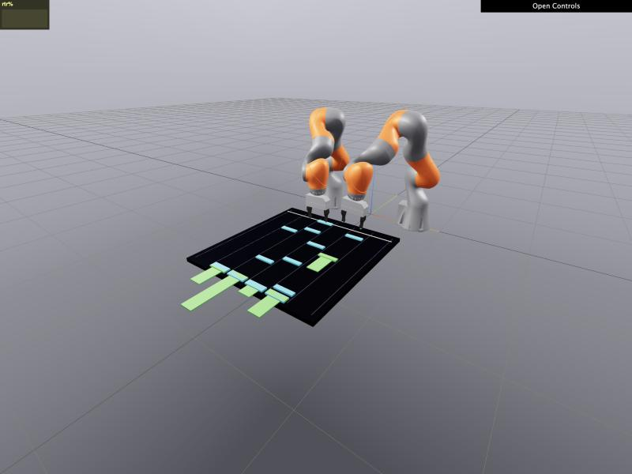
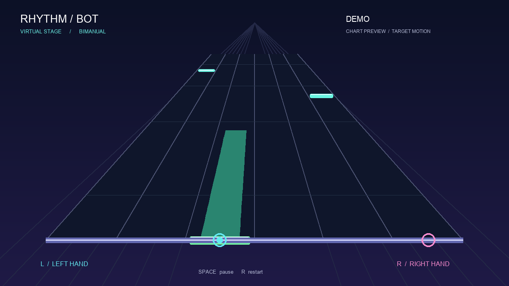
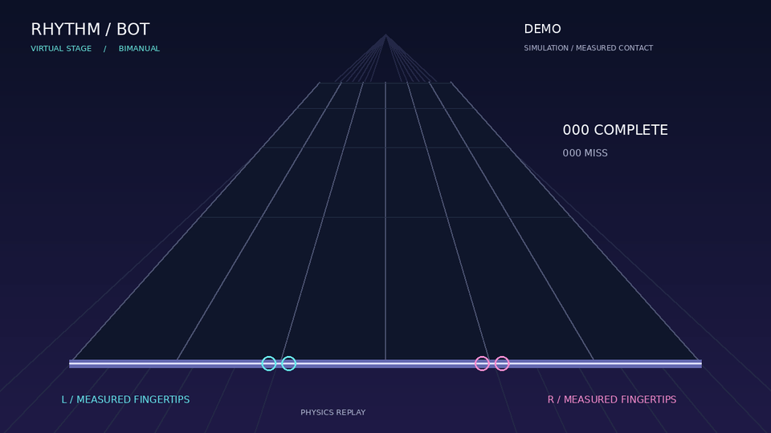
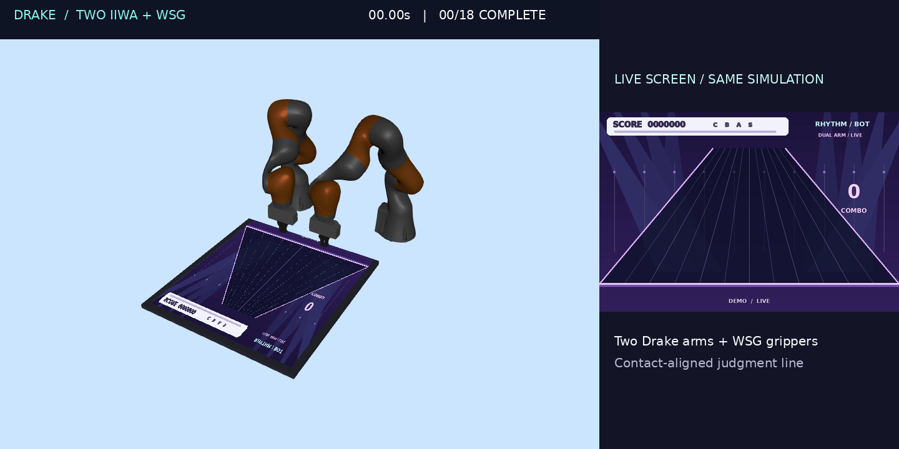
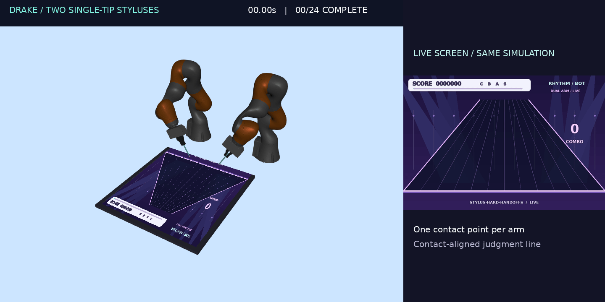
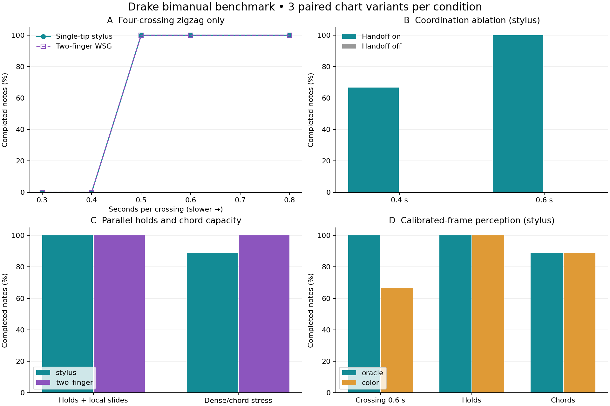
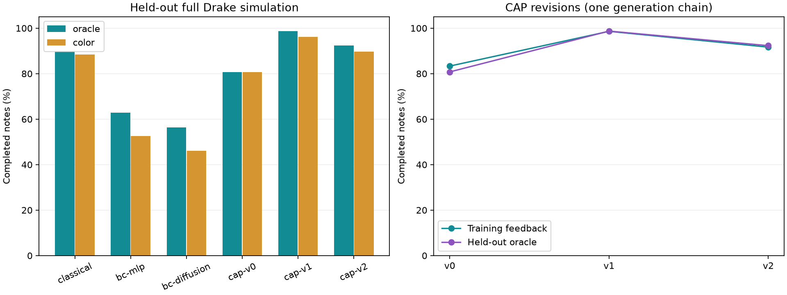
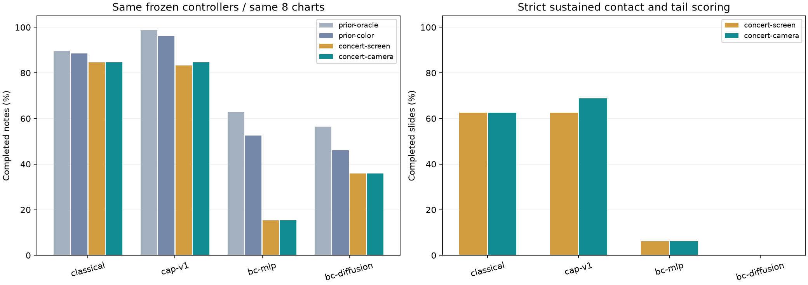

# RhythmBot — simulation pipeline

## Start here: current bimanual Sekai-camera handoff

**The target environment is two Drake iiwa arms, closed WSG grippers with one
stylus contact per arm, the Sekai-inspired concert display, and camera RGB-only
vision.** Use the unified evaluator's `sekai-camera` preset. A plain invocation
of `evaluate` still selects the legacy single-arm/oracle environment; it is **not**
the target experiment.

```sh
HEADLESS=1 python -m rhythmbot.evaluate --preset sekai-camera \
  --split bimanual-smoke --policy classical cap:results/yifan-study-v1/cap/v1/policy.py \
  --workers 2 --out results/sekai-camera-smoke
```

This explicitly selects two single-tip arms, `view=camera`, `detector=concert`,
and the calibrated 960×720 camera. Each custom policy gets an independent instance
per arm. For the same artwork without the camera, use `--preset sekai-screen`
and a **different output directory**. For all eight committed charts, replace
`bimanual-smoke` with `bimanual-test`.

**[Complete handoff: commands, BC checkpoint retrieval, environment matrix,
validation and remaining work](docs/HANDOFF.md).**

The latest base is Anna's `5c644a7`, including the stricter touch-landing rule.
The earlier 64-run camera table and GIFs are **historical results under the prior
judge**, not a re-evaluation of this base. The new handoff validation lives in
`results/handoff-20261113/`; it checks the unified entry point, not a new complete
benchmark. Do not mix it with `results/eval-v2/` (single arm, simpler screen,
trained detector) or call those results bimanual camera results.

The screen is dynamically composited into Drake RGB with correct robot occlusion.
Only the environment renderer uses render labels; vision receives RGB and a clock,
with known geometric calibration. This is classical RGB vision, not a VLM or a
physical-camera experiment.

## Background and historical experiments

The sections below cover multiple older environments. Their commands and scores
must be read with their own settings; the handoff above is the current entry point.

A simulated KUKA iiwa (with the course's Schunk WSG gripper) playing a
Project SEKAI–style rhythm game in Drake: **tap**, **hold** and **slide**
notes on a touch surface, with the notes delivered to the robot by a
perception stage with separate oracle, trained-detector and calibrated RGB modes.

The design borrows from [GuitarHeroBot](https://github.com/JRed46/GuitarHeroBot)
(6.4210, Fall 2023): a `MakeHardwareStation` iiwa+WSG scene, notes written as
`(lane, start, duration)`, pre-press / press / post-press gripper keyframes
joined by a linear `PiecewisePose`, differential IK into the station's
position port, and a color-segmentation perception pipeline. What is new is
everything the proposal asks for beyond button presses: continuous slides,
holds, a closed-loop perception→plan→control loop that replans as notes come
into view, a touch judge with the game's timing windows, and a pluggable
policy interface for the LLM / behavior-cloning comparisons.

```
chart.json ──► GameScreen ───frame───► RhythmBrain ──X_WG_desired──► DiffIK ──q──► HardwareStation
                 (2D render)            │ NoteDetector                                 │ body_poses
                                        │ tracker + Policy (ClassicalPlanner)          ▼
HighwayVisualizer (3D notes in Meshcat) │                                         TouchSensor ──► Judge ──► report.json
```


*What the perception stage sees (`FrameRenderer`), at five moments of the
demo chart: cyan taps, a green hold (second frame: active, head pinned to
the judgment line), magenta slides (fourth frame: active, clipped at the
line), and two-note chords.*

## Running

Everything runs from the repository root. In the course folder the course
venv already has every dependency:

```bash
cd ~/mit/64210/project
../.venv/bin/python -m rhythmbot.play --demo --hold
```

In a fresh clone, make a Python 3.13 environment from `requirements.txt`
(torch is only needed for the vision model):

```bash
uv venv --python 3.13 && uv pip install -r requirements.txt
.venv/bin/python -m rhythmbot.play --demo --hold
```

The trained vision model and the result reports are committed under
`results/`. The training frames (`data/`) are not; regenerate them with
`rhythmbot.dataset` before retraining.

Open the Meshcat URL it prints. `--hold` keeps the server up after the song
so the recording can be scrubbed (`Open Controls → Animations`).

| command | what it does |
|---|---|
| `HEADLESS=1 python -m rhythmbot.play --demo` | no browser, fastest; prints and saves the score report |
| `python -m rhythmbot.play --chart charts/random-1.json --detector color` | play a chart file using the image-based detector |
| `python -m rhythmbot.play --random 7 --noise 0.03 --latency 0.15` | random chart, oracle detector with timing jitter and detection delay |
| `python -m rhythmbot.play --chart charts/song.json --arms 2` | play with two arms on wider lanes (reports get a `-2arm` suffix) |
| `python -m rhythmbot.play --demo --audio --hold` | with a soundtrack synthesized from the chart (needs `afplay`, i.e. macOS, or `aplay`/`ffplay`) |
| `python -m rhythmbot.play --detector torch --model results/note_detector.pt` | play from the trained vision model |
| `python -m rhythmbot.dataset --out data/train --charts 80 --dense 80 --fps 10` | render labelled game frames for training (80 varied + 80 dense random charts) |
| `python -m rhythmbot.dataset --out data/preview --preview` | one contact sheet of frames to eyeball the rendering |
| `python -m rhythmbot.train --epochs 30` | train the note detector on `data/train`, validate on `data/val`, export `results/note_detector.pt` |
| `python -m rhythmbot.train --eval-only --model results/note_detector.pt` | detector metrics on the validation frames |
| `python -m rhythmbot.importers song.osu --out charts/` | import a real chart (osu!mania `.osu`, StepMania `.sm`/`.ssc`, Clone Hero `.chart`) |
| `python -m rhythmbot.importers --guitarherobot --out charts/` | GuitarHeroBot's hand-transcribed *Slow Ride* charts (easy/medium/hard) |
| `python -m rhythmbot.play --chart charts/song.json --song song.mp3 --tempo 0.6` | play an imported chart with its song, both slowed to 60 % |

Reports land in `results/<chart>-<detector>.json`.

## Results (classical planner, three perception stages)

All headless, default config. Completion counts a note only if it was hit
on time *and*, for holds and slides, contact was kept for ≥80 % of it.
The oracle and the color-segmentation detector complete every note of
every chart below with every note judged "perfect" (timing error within
±10 ms), so the table shows the trained vision model against that ceiling.

| chart | notes | vision model: completion | judgments (perfect/great/good/miss) | timing error mean ± std |
|---|---|---|---|---|
| demo | 18 | 100% | 18/0/0/0 | −2 ± 14 ms |
| random-1 | 15 | 100% | 15/0/0/0 | +7 ± 5 ms |
| random-2 | 21 | 100% | 21/0/0/0 | +6 ± 4 ms |
| random-3 | 19 | 100% | 19/0/0/0 | +8 ± 6 ms |
| slow-ride-easy (Guitar Hero III) | 14 | 100% | 14/0/0/0 | +4 ± 5 ms |
| slow-ride-medium | 18 | 100% | 18/0/0/0 | +7 ± 6 ms |
| slow-ride-hard | 33 | 100% | 33/0/0/0 | +14 ± 7 ms |
| **all** | **138** | **100%** | **138/0/0/0** | |

Holds keep contact for their whole length, including the 7 s sustain that
ends every Slow Ride chart; slides keep contact for 92–100 % of their
length with 6–11 mm RMS lateral error (lane width 50 mm).

Every note is now judged "perfect". The previous model's timing error std
was 26–35 ms on Slow Ride, which repeats notes in one lane every 0.2–0.3 s
so several heads crowd the bottom of the frame at once; 11 Slow Ride notes
were "great" or "good", and with the gripper-roll planner it lost one
0.25 s hold on Slow Ride Medium (hit 50 ms early, contact for 73 %). The
dense training charts (last row below) brought that std down to 5–7 ms.

**How it got here.** The first model, with two slots per lane and trained
on narrower random charts, completed 15 of 18 notes on Slow Ride Medium.
Each row below is all seven charts, with every change kept from the rows
above it.

| step | completed |
|---|---|
| training charts widened to real-chart statistics, 3 slots, log-scaled duration, 24 epochs | 133 / 138 |
| planner re-decides skipped notes on every replan | 134 |
| active slot (note being played, time to its end) | 135 |
| tracker drops upcoming notes unreported for 0.2 s | **138** |
| dense osu!mania-style training charts, 8 slots, 24 feature rows, 30 epochs | **138**, all perfect |

The last three rows are fixes found by running the model in the loop. A
note skipped early on a wrong belief (say, a previous hold's duration
briefly overestimated) used to stay skipped for good. The active slot fixed
the long holds. And on Slow Ride's runs of same-lane notes the model
sometimes flips a note between tap and hold from frame to frame, which left
a phantom duplicate that held the finger down through the next real note.
The last row is what closed the gap on the dense osu!mania difficulties
(see *Harder difficulties of the same song*). The previous models are kept
as `results/note_detector_v5.pt` (3 slots) and `results/note_detector_v4.pt`.

Vision model on the 2431 held-out validation frames of the earlier,
varied-only charts (`dataset.py --out data/val_v5 --charts 12 --seed 1000`,
then `train.py --eval-only --val data/val_v5`): upcoming notes
precision 1.000 / recall 1.000, kind accuracy 1.000, time-to-hit MAE 10 ms
(20 ms for the previous model), path-lane MAE 0.18 lanes, duration MAE
0.38 s (guessed before the hit, often with the tail off-screen); notes being
played precision 1.000 / recall 1.000, end-time MAE 9 ms once the end is in
view, and every off-screen end correctly reported as off-screen. On the
current 4962 validation frames, half of them from dense charts: precision
1.000 / recall 1.000, kind accuracy 0.996, time-to-hit MAE 15 ms (p95
45 ms), active end-time MAE 7 ms.

Noisy-oracle check: with 30 ms hit-time jitter and 150 ms detection
latency the oracle still completes 18/18 on the demo.

## Importing real songs

`rhythmbot/importers.py` reads the chart formats of three popular rhythm
games and writes our JSON:

| format | game | what maps |
|---|---|---|
| `.osu` (Mode 3) | osu!mania | columns → lanes, circles → taps, mania holds → holds, first timing point → BPM, `AudioFilename` → `Chart.audio` |
| `.sm` / `.ssc` | StepMania, In The Groove | 4 panels → centre lanes, beats → seconds through `#BPMS`/`#STOPS`/`#OFFSET`, holds and rolls → holds, `#MUSIC` → audio |
| `.chart` | Clone Hero / Guitar Hero (Moonscraper) | 5 frets → lanes 0–4, ticks → seconds through `[SyncTrack]`, sustains → holds, `MusicStream` → audio |
| notebook tuples | GuitarHeroBot's *Slow Ride* | buttons → lanes, `13` chords → two taps, sustains → holds |

None of these games has slides, so imported charts contain taps and holds
only. Game columns beyond six are spread across the lanes
(`importers.map_columns`). What is **not** imported is the music itself:
beatmaps and song packs are copyrighted, so point `play --song` at an audio
file you own (or the chart's own `audio` entry, resolved relative to the
chart file). Real charts are usually denser than one fingertip can play, so
`--tempo 0.6` slows chart and song together (`afplay -r`), and
`importers --min-gap 0.25` thins notes that follow another too closely.

The *Slow Ride* charts are in `charts/slow-ride-*.json`; they are the
numbers GuitarHeroBot's authors typed into their notebook, so they play
without any song file (silently, or with `--audio` for the synthesized
track).

## Playing a real osu!mania beatmap

The first real chart played end to end is a ranked osu!mania map:
*NekoTeto feat. Kasane Teto SV* by d0tc0mmie (an osu! Featured Artist,
so the music is licensed to osu!), difficulty "[4K] Easy Neko" by
RhythmHomura, beatmap 5711487, 1.1 stars. Only the chart text was
fetched, from the official site's public `osu.ppy.sh/osu/<beatmap id>`;
the song audio was not downloaded, so live runs use `--audio`. To
reproduce:

```bash
mkdir -p songs/nekoteto && curl -sSL -o songs/nekoteto/easy-neko.osu https://osu.ppy.sh/osu/5711487
python -m rhythmbot.importers songs/nekoteto/easy-neko.osu --out songs/nekoteto/easy-neko.json
python -m rhythmbot.play --chart songs/nekoteto/easy-neko.json --detector torch --model results/note_detector.pt --audio --hold
```

`songs/` is gitignored. If you download the full beatmap from osu! and put
its `audio.mp3` next to the `.osu`, `play` uses the real song
automatically, delayed by the importer's lead-in (`--lead-in`, default
2.5 s, since the map's first note is at 0 s). Measured against the decoded
`audio.mp3` (spectral-flux onsets, low band and full spectrum agreeing),
the music's beats land about 80 ms after the chart's note times, so the
imported chart starts this song 80 ms early (`audio_offset` 2.42 s). If a
live run still sounds off, adjust by ear with `play --song-offset`.

The map has 244 notes (200 taps, 44 holds) over 96 s on four lanes,
with 20 two-note chords and notes never closer than 0.29 s.

| detector | completed | judgments (perfect/great/good/miss) | timing error mean ± std |
|---|---|---|---|
| oracle | 243 / 244 (99.6 %) | 243/0/0/1 | +8 ± 4 ms |
| color segmentation | 243 / 244 (99.6 %) | 243/0/0/1 | +7 ± 4 ms |
| vision model | 243 / 244 (99.6 %) | 243/0/0/1 | +7 ± 4 ms |

osu!mania assumes independent fingers: hold one key, tap others. The
WSG's two fingertips move up and down together, so at first, while one
pressed a hold, the other could not tap. The robot then completed 220 / 244
with the oracle and color detectors and 218 with the vision model. 21 of
the 24 oracle misses were notes starting while a hold in another lane was
still down, on this map usually at the moment the hold ends.

**Rolling about the hold finger.** The planner now keeps a hold with one
fingertip and plays the notes around it with the other. The WSG opens so
the free fingertip is over the next note's lane, and the hand rolls about
world y through the holding fingertip: the free fingertip waits 10 mm above
it, dips to the screen for the note and rises again. When the free
fingertip lands a hold that outlasts the first, the two swap roles: the
new hold finger becomes the pivot and the old one lifts. Keyframes say
which point they place (`Keyframe.ref`: the midpoint or one fingertip) and
how far one fingertip is above the other (`Keyframe.rise`), and `Plan`
interpolates each segment about its reference point, so the holding
fingertip stays put while the hand rolls and reopens. A hold's fingertip,
position and opening are fixed once it is down (`TrackedNote.held`), so
replans keep it where it landed. Lanes 1 and 4 are 15 cm apart, more than
the WSG's 13 cm, so two fingertips may each land up to 12 mm off their
lane centres (lanes are 50 mm wide); that also makes the two 1+4 chords
playable.

In the oracle run, rolls stay under 15°, the arm stays at least 0.31 rad
from every joint limit, and a holding fingertip slides at most 10 mm
within its lane during a hold (6 mm at the 90th percentile; 7.5 and 4 mm
before rolling) and stays within 12.5 mm of the lane centre. The slide
comes from the station's arm controller lagging the command by roughly
40 ms during the quickest rolls. Reopening the WSG about a holding
fingertip swings the whole gripper sideways, so it is capped at 1 m/s
(`Motion.pivot_width_speed`). The regression charts above still score
100 % with the oracle and color detectors, and the noisy oracle (30 ms
jitter, 150 ms latency) also completes 243 / 244 here.

The one note the oracle run misses, #125, is a lane-4 tap at the moment a
lane-1 hold ends and a lane-3 hold starts: three lanes at once. The color
detector run keeps that tap and drops the hold instead. The vision model
misses the same note as the oracle and nothing else (the previous,
3-slot model also lost two taps, #151 and #154, and the hold #136).

### Harder difficulties of the same song

The full beatmap download (`songs/nekoteto/`, from the official osu! page;
gitignored) has four harder 4K difficulties of the same song, imported the
same way with the same 80 ms song offset. Results with one arm (two arms are
below, in *Two arms*):

| difficulty | stars | notes | notes/s | oracle completion | vision model completion | previous vision model (3 slots) | mean \|timing error\|, oracle / vision |
|---|---|---|---|---|---|---|---|
| Easy Neko | 1.10 | 244 | 2.5 | 99.6 % | 99.6 % | 98.4 % | 8 / 7 ms |
| Normal Neko | 1.64 | 446 | 4.7 | 82.7 % | 81.8 % | 66.6 % | 26 / 24 ms |
| Advanced Neko | 2.49 | 759 | 7.9 | 71.7 % | 71.5 % | 50.1 % | 24 / 24 ms |
| Llee's Hard Neko | 2.88 | 907 | 9.5 | 66.5 % | 67.1 % | 53.4 % | 25 / 24 ms |
| Nyanyannyanyan | 3.85 | 1206 | 12.6 | 59.1 % | 57.2 % | 42.1 % | 26 / 25 ms |

Where the oracle's misses came from before the planner and tracker fixes
below. These rows are not all physics: the first, especially, was partly the
planner's own timing and choices.

| why the oracle run missed a note | Normal | Advanced | Hard | Nyan |
|---|---|---|---|---|
| lane change needed in under 0.15 s | 68 | 80 | 191 | 204 |
| 3 or more lanes at once (2 fingertips) | 0 | 141 | 115 | 381 |
| two lanes wider apart than the gripper opens | 7 | 16 | 30 | 25 |
| hit, but hold let go early | 3 | 21 | 32 | 53 |
| same-lane repeat or other timing | 7 | 10 | 24 | 11 |

The vision model now plays these maps as well as the oracle. The previous
model trailed by up to 15 points because these maps were outside its
training data: up to 8 notes queue in one lane on screen against its 3
slots per lane, most notes are 0.05–0.3 s holds, and its training charts
never put notes closer than 0.18 s. On rendered frames of Normal Neko it
found only 58 % of the upcoming notes (29 % on Nyanyannyanyan) and misread
short holds' hit times by up to 0.1 s. The current model, trained with
`chart.dense_random_chart` charts in the mix and 8 slots per lane, finds
99.7 % (95.6 %) within 60 ms, with 9–16 ms time-to-hit error and 15–26 ms
hold-duration error.

The oracle is a guide rather than a true ceiling on these maps, which ask for
more than one hand can play: the planner has to choose, and small timing
differences change its choices. On Nyanyannyanyan vision and the oracle share
559 completed notes, with 154 only by the oracle and 131 only by vision, and
color segmentation (59.8 %) edges past the oracle.

**Scoring note.** The table above uses the judge's stricter touch rule (see
*A stricter judge*). Percentages quoted in the fixes below, up to and including
*Chords with a hold*, were measured under the earlier rule, so they run 1–4
points higher with one arm than this table.

**Close notes in the tracker.** The tracker used to match each detection to
the nearest tracked note of the same kind and lane within 0.15 s, and several
detections could match one note. A same-lane note under 0.15 s after another
could therefore merge into it, with the hit time averaged between the two.
The oracle had the same problem, because a note id not tracked yet fell
through to that same match. Now a frame's detections are assigned one to one,
closest pairs first (`RhythmBrain._assign`), and ids match only ids. A
leftover detection within 0.07 s of a tracked note counts as a double report
(`Perception.min_note_gap`), since heads that close would merge on screen.

Replaying the vision model through the tracker without the arm, every note
of Hard and Nyanyannyanyan now ends up tracked (24 and 8 were lost before).
In the full runs, completed notes among those in such close pairs rose from
68 to 78 of 102 on Hard and from 84 to 99 of 144 on Nyanyannyanyan with
vision, and from 57 to 82 and from 38 to 62 with the oracle. Overall
completion rose less, from 57.8 to 58.3 % and from 48.2 to 49.3 % with
vision and from 56.8 to 58.2 % and from 44.1 to 44.3 % with the oracle,
because the arm's time is limited and playing these notes displaces others.
Easy, Normal and Advanced did not change.

**Chains of short holds.** Most of Normal Neko's misses were notes due just
as a 0.146 s hold in another lane ends. The planner ran the free fingertip's
lift (80 ms), the reopening (up to 90 ms) and the dip (80 ms) strictly one
after another, which does not fit. Reopening now starts once the lifting
fingertip is clear of the screen and may run on through a dip as short as
30 ms (`Motion.roll_min_dip_time`). Vision completion rose from 80.9 to
83.6 %, 63.9 to 68.8 %, 58.3 to 58.9 % and 49.3 to 51.8 %, and the oracle's
from 80.9 to 84.1 %, 64.7 to 69.7 %, 58.2 to 59.8 % and 44.3 to 46.8 %.

This has costs. These notes land later and the arm is working harder: on
Normal, with the oracle, mean |timing error| went from 24 to 31 ms, notes
judged "perfect" from 313 to 306 and "great" from 28 to 45, holds losing
contact from 3 to 9, and 90th-percentile holding-fingertip slide from 14.5
to 19.4 mm. Easy Neko and the regression charts did not change.

At that stage the planner still skipped 59 notes on Normal. For 39 the free fingertip was on
the wrong side, typically in chains running one way across lanes (1→2→3):
with one fingertip holding lane 2, the other cannot reach lane 3, and no roll
can fix that. 19 needed the gripper to reopen
by 90 mm, which does not fit the time even overlapped. Two things were tried
and left out. Hopping the hand across by letting go of the hold early and
landing late, within the judge's slack, added only 0–3 notes per map with
vision. A 60 ms lift added 4, 7, 18 and 8 notes with vision but raised the
worst holding-fingertip slide on Easy Neko from 10.3 to 17.9 mm.

**Choosing what to play.** The planner used to play whatever came next if it
looked possible, which caused two problems. It attempted notes the hand could
not reach: on Hard and Nyanyannyanyan, notes under 0.12 s after one in another
lane succeeded only 5–38 % of the time (about 220 attempts), against about 95 %
from there up, and each failed dash also spoiled what followed. And it never
gave up one note to save two. Now a note needs at least 70 ms from lift-off
when the hand has to move (`Motion.min_lateral_gap`), and `_select` runs a beam
search over the notes in view, trying each choice with the real keyframe logic
(`_step`) so it is judged by what it leaves reachable. In a three-note chord it
also chooses which two to play. Notes the hand has started toward are kept
unless impossible, and a small bonus for agreeing with the previous plan stops
it flipping between equal choices. Completion rose, with vision, from 83.6 to
84.3 %, 68.8 to 71.0 %, 58.9 to 68.0 % and 51.8 to 56.3 %, and with the oracle
from 84.1 to 85.2 %, 69.7 to 73.4 %, 59.8 to 70.0 % and 46.8 to 59.0 %. The
search is cheap: beam widths of 2 and 24 score nearly the same, and runs got
faster because the hand stops chasing lost notes.

**Chords with a hold.** A chord that included a hold used to lose all but one
note. Now both fingertips land together, the one on the shorter note lifts when
that note ends, and the other stays down as the pivot for rolling (`_hold_chord`).
With one arm, completion rose from 71.0 to 72.9 %, 68.0 to 69.8 % and 56.3 to
59.5 % with vision (Normal did not change). With two
arms, where this was nearly the only thing left, it took Advanced from 92.4 to
99.9 %.

**A stricter judge.** On a second song the one-arm runs showed notes judged
"good" about 0.15 s early on an easy chart. Both fingertips land together, only
one was marked as used, and the other stayed down and dragged into the next
lane, which the judge counted as a new touch. A touch must now land inside the
note's lane, and a note uses up every fingertip that landed in its lane. With
one arm and the oracle, this lowers completion from 85.2 to 82.7 %, 73.1 to
71.7 %, 70.9 to 66.5 % and 61.3 to 59.1 %. Timing error also drops, because the
dragged touches were the worst ones (from 28–38 ms to 24–26 ms). The regression
charts and every two-arm result are unchanged: fixed fingertips do not drag.

Reports are in `results/neko-<difficulty>-<detector>.json`.

### Two arms



*`--arms 2`: two iiwa + WSG arms with their bases 66 cm apart, playing Normal
Neko.*

`--arms 2` puts a second arm beside the first. Each hand plays its half of the
screen, with a fingertip fixed over each of the two lanes next to the middle,
and rolls to press one or the other, so moving between its two lanes takes no
travel. The same `ClassicalPlanner` runs per hand. The vision model needs no
retraining, because the game frame is drawn in pixels and lane width only
changes the world geometry.

| difficulty | vision, 1 arm → 2 arms | oracle, 2 arms | color, 2 arms | judgments, vision (perfect/great/good/miss) | mean \|timing error\|, vision, 1 → 2 arms |
|---|---|---|---|---|---|
| Easy Neko | 99.6 → **100 %** | 100 % | 100 % | 244/0/0/0 | 7 → 5 ms |
| Normal Neko | 81.8 → **100 %** | 100 % | 100 % | 446/0/0/0 | 24 → 10 ms |
| Advanced Neko | 71.5 → **99.9 %** | 100 % | 100 % | 756/2/0/1 | 24 → 13 ms |
| Llee's Hard Neko | 67.1 → **97.8 %** | 97.7 % | 97.7 % | 832/52/5/18 | 24 → 18 ms |
| Nyanyannyanyan | 57.2 → **93.9 %** | 93.4 % | 93.7 % | 1005/126/6/69 | 25 → 24 ms |

Of the oracle's remaining misses on Hard (21) and Nyanyannyanyan (80), most are
very fast repeats in one lane, where the whole hand has to lift and come back,
and notes due just as a hold on the same hand ends. The noisy oracle (30 ms
jitter, 150 ms latency) also completes 100 % of Advanced Neko.

**Lanes are wider.** The WSG body is 146 mm wide, so at 50 mm lanes the hands
would collide. At 100 mm they still touched while rolling on Nyanyannyanyan. At
the 120 mm chosen (`two_arm_config`), the closest the two hands' collision
geometry comes is 42 mm, on Cityyy – Unknown's top difficulty (48 mm on
Nyanyannyanyan).

**Measured motion.** On Nyanyannyanyan, rolls stay around 8° at most, the arms stay at
least 0.41 rad from every joint limit, and a holding fingertip slides at most
12.8 mm (6.3 mm at the 90th percentile; 6.2 and 3.3 mm on Advanced). No hold
loses contact on Normal, Advanced or Nyanyannyanyan. Arm links stay
at least 165 mm apart, measured between link frame origins, since the iiwa
model has no collision geometry.

**Joint speeds.** Neither setup stays inside the iiwa's joint speed limits on
dense maps, and the simulated controller does not enforce them on the actual
motion. Two arms are much closer. This is the main thing that would stand
between these numbers and real hardware.

| map | 1 arm: time over limit, peak | 2 arms: time over limit, peak |
|---|---|---|
| Normal | 25.7 %, 209 % of limit | 1.1 %, 134 % |
| Advanced | 29.6 %, 222 % | 2.6 %, 140 % |
| Hard | 26.6 %, 237 % | 7.1 %, 169 % |
| Nyanyannyanyan | 22.4 %, 218 % | 11.3 %, 169 % |

**What two arms lose.** Wider lanes and a fixed split cost the charts that use
all six lanes. Slides that would bring a hand into the other's half are skipped,
and chords two lanes apart on one hand no longer fit the WSG's 130 mm reach:

| chart | notes | 2 arms (all three detectors) | why |
|---|---|---|---|
| demo | 18 | 16 | 2 slides |
| random-1 | 15 | 12 | 2 slides and a tap |
| random-2 | 21 | 19 | 2 slides |
| random-3 | 19 | 17 | 2 slides |
| slow-ride-easy | 14 | 14 | |
| slow-ride-medium | 18 | 18 | |
| slow-ride-hard | 33 | 20 | 13 chords on lanes 0 + 2 |

One arm remains the default and still completes all of
these. Two-arm reports are in `results/*-2arm.json`.

### A second song: Cityyy – Unknown

To test on a song nothing was tuned on: *Unknown* by Cityyy, an osu! Featured
Artist (beatmap set 2553938, mapped by RhythmHomura, 190 BPM, 91 s). It has
eight 4K difficulties and, unlike NekoTeto, almost no holds. The vision model
was not retrained. Vision model completion, then oracle:

| difficulty | stars | notes | notes/s | 1 arm: vision / oracle | 2 arms: vision / oracle | judgments, 2 arms, vision (perfect/great/good/miss) | mean \|timing error\|, vision, 1 → 2 arms |
|---|---|---|---|---|---|---|---|
| Easy | 1.26 | 282 | 3.1 | 99.3 / 99.3 % | **100** / 100 % | 282/0/0/0 | 15 → 7 ms |
| Intermediate | 1.44 | 341 | 3.7 | 97.7 / 97.9 % | **100** / 100 % | 341/0/0/0 | 20 → 8 ms |
| Normal | 1.93 | 483 | 5.3 | 98.6 / 99.8 % | **100** / 100 % | 483/0/0/0 | 19 → 6 ms |
| Advanced | 2.46 | 664 | 7.3 | 99.5 / 99.5 % | **100** / 100 % | 664/0/0/0 | 22 → 9 ms |
| Hard | 3.14 | 905 | 10.0 | 84.4 / 86.1 % | **99.4** / 99.4 % | 859/40/1/5 | 25 → 17 ms |
| Hyper | 3.46 | 974 | 10.7 | 78.0 / 79.9 % | **99.5** / 98.6 % | 870/98/1/5 | 24 → 21 ms |
| Insane | 3.76 | 1059 | 11.6 | 72.4 / 76.1 % | **98.2** / 97.0 % | 833/205/2/19 | 25 → 25 ms |
| Extra | 4.16 | 1172 | 12.9 | 64.4 / 69.7 % | **91.2** / 90.0 % | 737/322/10/103 | 31 → 33 ms |

"Extra" stands for the top difficulty, whose real name is a string of symbols.
On it, two arms exceed the joint speed limits more than one arm does (17.8 % of
the time against 11.3 %, both peaking at 188 %), since the one-arm run skips more
notes. To reproduce, fetch each chart from `osu.ppy.sh/osu/<beatmap id>` (5679964,
5679967, 5676157, 5676155, 5676156, 5670174, 5670175, 5677829, in the table's order) and:

```bash
python -m rhythmbot.importers songs/cityyy-unknown/hard.osu --out songs/cityyy-unknown/hard.json
python -m rhythmbot.play --chart songs/cityyy-unknown/hard.json --arms 2 --detector torch --model results/note_detector.pt --audio --hold
```

The song audio is not in the repository and has not been lined up with these
charts yet, so live runs use `--audio`. Reports are in
`results/cityyy-<difficulty>-<detector>[-2arm].json`.

## Modules

| file | role |
|---|---|
| `rhythmbot/config.py` | every tunable: lane geometry and frame conventions, judgment windows, gripper offsets, planner shape, perception rate |
| `rhythmbot/chart.py` | `Note`/`Chart`, JSON load/save, `random_chart` / `varied_random_chart` / `dense_random_chart` generators, built-in demo |
| `rhythmbot/game.py` | `FrameRenderer` (2D game screen → `uint8` image + pixel labels) and `HighwayVisualizer` (same notes as moving Meshcat geometry) |
| `rhythmbot/perception.py` | `NoteDetector` interface; `OracleDetector`, `ColorSegmentationDetector`, `TorchDetector` |
| `rhythmbot/planner.py` | `Policy` interface and `ClassicalPlanner` (look-ahead choice of notes, keyframes → fingertip pose, rolled about a holding fingertip when needed, + gripper width; one per arm) |
| `rhythmbot/brain.py` | `GameScreen` and `RhythmBrain` LeafSystems: perception tick, note tracking, replanning, pose output |
| `rhythmbot/robot.py` | scene YAML/SDF for one or two arms, hardware station, DiffIK integrator and start-pose IK per arm, `TouchSensor` |
| `rhythmbot/judge.py` | timing/contact scoring and the JSON report |
| `rhythmbot/play.py` | builds the diagram, runs, reports |
| `rhythmbot/dataset.py` | labelled frame generation for the vision model |
| `rhythmbot/train.py` | the vision model (`NoteNet`), its training loop, validation metrics and TorchScript export |
| `rhythmbot/audio.py` | soundtrack synthesized from the chart, or a song file, played in sync with a live run |
| `rhythmbot/importers.py` | osu!mania, StepMania and Clone Hero chart importers; GuitarHeroBot's Slow Ride |
| `rhythmbot/policies.py` | every policy by name: `classical`, `cap:<policy.py>`, `bc:<model.pt>` (`play --policy`) |
| `rhythmbot/splits.py` | chart splits: `cap-train`, `bc-train`, and the held-out `heldout-iid` / `heldout-dense` / `heldout-real` / `heldout-song` |
| `rhythmbot/evaluate.py` | runs policies × detectors × a split headless in parallel; `summary.md` with completion, timing, contact, slide error; per-run time limit, provenance on every report, warnings for mixed scoring rules and missing song charts |
| `rhythmbot/failures.py` | sorts every failed note of an evaluation into perception, lost contact, beyond the robot, skipped or missed head |
| `rhythmbot/cap/` | code-as-policy: `TASK.md` (the agent's problem statement), `api.py` (the control API generated programs use), `sandbox.py` (import check + guarded execution), `feedback.py`, `loop.py` (the agent ↔ simulator refinement loop) |
| `rhythmbot/bc/` | behavior cloning: `features.py` (observation / action-chunk encoding), `train.py` (demos from the classical planner + DAgger), `policy.py` (`BCPolicy`) |
| `charts/` | demo and three random charts |

## How the pieces work

**Scene.** The iiwa base is at the world origin; the course's default joint
angles point the arm along −y, so the touch screen is laid in front of it
there. Lanes run along world x (lane 0 at −x), notes travel toward the robot
along +y and are hit at the judgment line `y = −0.50`. The screen slab is
visual-only: a position-controlled arm pressing into a rigid welded box only
fights the contact solver, and a touchscreen does not push back. Touch is
sensed geometrically from the station's `body_poses`: a fingertip is "down"
when it is within 4 mm above the screen plane. Fingertip points were measured
off the WSG model (finger frames 77 mm out along the gripper's y, finger
meshes 41 mm beyond that; fingers slide along the gripper's x).

**Perception.** `GameScreen` renders what a player would see, at the
perception tick (30 Hz) and only if the detector asks for pixels. The
`ColorSegmentationDetector` is GuitarHeroBot's HSV trick in numpy/scipy:
mask each note color, label connected blobs, bottom edge → hit time, centre
→ lane, top edge → end, centre column per row → slide path. A note already
being played has its head pinned on the judgment line (as in the game) and
is reported with `active=True`, so the tracker refines only its end time.
`TorchDetector` runs the trained model described next.

**Vision model (`train.py`).** `NoteNet` is a four-stage CNN whose feature
map is resampled to one column per lane and read by an MLP shared across
lanes. For each lane it predicts nine slots:

* eight **upcoming** slots, the eight nearest note heads in that lane that
  have not reached the judgment line, each with a presence logit, a kind
  (tap/hold/slide), time to hit, duration, and the note's lane at
  25/50/75/100 % of its duration, which is the slide path;
* one **active** slot, the hold or slide being played in that lane right
  now (its head pinned on the line), with a presence logit, a kind
  (hold/slide) and the time left until it ends.

The active slot exists because of long holds. Before the hit, the end of a
hold longer than the 1.6 s approach time is above the top of the frame, so
its duration can only be guessed; it comes into view only while the hold is
being played. The brain treats an active report whose end is still
off-screen as a lower bound and keeps extending the hold, and once the end
is in view it replaces the earlier guess with the measured end, correcting
overestimates as well as underestimates. Slides get their predicted path
stretched to the corrected duration.

Input is the full 256×384 frame; the module downsamples by two inside
`forward`, so `TorchDetector` only normalises pixels to [0, 1]. The last
CNN stage halves only the width, so each lane column is read from 24 rows
of features, one per ~0.08 s of scroll, about the closest two heads in a
dense lane get. Durations are log-scaled so 0.05 s holds and 7 s holds are
both learnable. Training data is `dataset.py` output at 10 fps from 160
charts, ~33k frames: 80 from `chart.varied_random_chart` (playable charts
whose density, hold lengths, gaps and lane repetition are themselves
randomised; these have the slides) and 80 from `chart.dense_random_chart`
(osu!mania-like: notes on a beat grid down to 0.045 s, up to ~13 notes/s,
two- to four-note chords, short holds down to 0.05 s, same-lane runs,
four, five or six lanes in use, up to 8 heads queued per lane).
Validation uses 12 unseen charts of each kind. Training takes 30 epochs,
about 22 minutes on Apple MPS.

Note heads stay `game.HEAD_TIME` = 0.055 s thick. Dense charts keep a
lane's next head at least 0.08 s after the previous head and 0.05 s after
the previous note's end, and the real maps are sparser per lane than that
(same-lane heads at least 0.097 s apart, a hold's end at least 0.073 s
before the next head). So heads never merge on screen, and thinner heads
would only have meant re-rendering everything and re-checking the color
detector. The export
is TorchScript plus a JSON sidecar with the normalisation constants and
slot layout, which `TorchDetector` reads, so older models still load.

Several robustness rules in the brain and planner came out of running the
model in the loop:

* a note is planned for only after it has been seen in two frames
  (`Perception.min_observations`), because the model occasionally emits a
  one-frame phantom just as a head crosses the judgment line;
* an upcoming note unreported for 0.2 s is dropped
  (`Perception.stale_after`): real notes are on screen and reported for the
  whole 1.6 s approach, so a silent one is a phantom or a duplicate left by
  the model flipping a note's kind between frames;
* a note first seen only once it is already being played is ignored, since
  its hit is lost and chasing it would only spoil the next note;
* the planner re-decides which notes to skip on every replan, freezing the
  decision only once the hand has started descending toward a note, so a
  skip based on an early wrong belief is undone when perception corrects it.

**Brain.** One abstract state updated in a periodic event (Drake-clean): a
dict of `TrackedNote`s merged from detections (matched by chart id when the
oracle supplies one, else by kind + lane + hit-time proximity, averaging the
hit time across frames), pruned when finished, then handed to the `Policy`
with the *currently commanded* fingertip pose so every replan is continuous
with the previous plan.

**Classical planner.** Per note: hover above the lane at `hit − 0.22 s`,
cross the contact height exactly at the hit time, press 2 mm, stay for a
tap dwell / hold duration / slide waypoints, lift. Between notes the tip
waits above the last note and leaves just in time to arrive at the next
hover. Two simultaneous taps up to three lanes apart become a chord: the WSG
opens so that one fingertip lands in each lane (`Gripper.width_for_tip_gap`).
A note due while a hold is still down is played by the other fingertip,
rolling the hand about the holding one (see *Playing a real osu!mania
beatmap*). Which notes to play is chosen by a look-ahead search (see
*Choosing what to play*); the rest are skipped explicitly and reported.

**Controller.** Drake's `DifferentialInverseKinematicsIntegrator` on an
arm-only plant (`MakeMultibodyPlant(..., add_frozen_child_instances=True)`
freezes the hand onto it so the `body` frame exists), with joint position
and velocity limits and nullspace centering on the start configuration. The
start configuration is solved with `InverseKinematics` so the arm begins
hovering over the middle of the judgment line.

**Judge.** At 200 Hz against the chart (ground truth, not the brain's
belief): notes need a *fresh* touch-down that lands in the lane within ±140 ms (perfect
≤45, great ≤90, good ≤140); holds and slides additionally need contact for
≥80% of their duration, slides within 0.6 lanes of the moving target; slide
RMS lateral error is recorded. Both fingertips are eligible, which is what
lets chords score.

## Code-as-policy and behavior cloning

Both approaches implement the same `Policy.plan(tracked_notes, t, X_WT_cmd,
width_cmd) -> Plan` as `ClassicalPlanner`, see the same tracked notes, and
are scored by the same judge (`play --policy ...`). Each is developed on its
own training charts and judged on held-out charts it never saw
(`rhythmbot/splits.py`):

| split | charts | what varies |
|---|---|---|
| `heldout-iid` | 10 `varied_random_chart` seeds 5000–5009 | nothing: same generator as training |
| `heldout-dense` | 5 random charts, 3.2 notes/s, 0.18 s gaps, 25 % chords | density, chords |
| `heldout-real` | demo, random-3, Slow Ride easy/medium/hard (+ NekoTeto Easy if `songs/` has it) | hand-made / real charts |

```bash
python -m rhythmbot.evaluate --policy classical bc:results/bc/teacher_diffusion.pt cap:<policy.py> \
    --split heldout --detector oracle torch --out results/compare
```

### Behavior cloning (`rhythmbot/bc`)

The classical planner is the demonstrator. Two observation encoders and two
action heads (`rhythmbot/bc/models.py`):

* **state**: the commanded hand state (x, height, opening, rise) and the
  next 8 tracked notes, each with its kind, time to hit and to end, and its
  lane at the hit and at 25/50/75/100 % of its length, *relative to the
  hand*; an MLP encodes it;
* **pixels**: the game frame itself (downsampled to 192 × 128) plus the hand
  state; a CNN (four stride-2 stages, flattened 12 × 8 map, so position on
  screen is kept) encodes it. No detector, no tracker: perception is learned;
* **mlp head**: regresses the hand state at the next 16 ticks (0.53 s),
  replanned every tick;
* **diffusion head** (a diffusion policy, Chi et al. 2023): DDPM over the
  normalized 16-tick action chunk, 100 noise levels, residual MLP denoiser
  conditioned on the observation and noise level (FiLM), 10 DDIM steps at
  run time; plays 4 ticks of each sampled chunk before sampling again.

Demonstrations need no physics: the brain only ever reads its own commanded
pose, so the brain + detector alone are simulated (0.3 s per 20 s chart
with the oracle). 200 `bc-train` charts give 127k labelled ticks; two DAgger
rounds (the learner drives 80 % of ticks on 100 charts each, the
demonstrator labels what it reaches) bring that to 254k. Pixel samples
store only (chart, time) and frames are re-rendered while training. Trained
on gpu156 (L40S): state models in 1–8 min, pixel models in 55–80 min
including DAgger rollouts.

**State → vision distillation** (`--teacher`): a state policy trained on
exact (oracle) notes is the teacher, and a pixel student is trained on its
labels: the teacher, which sees the oracle notes, labels every state, first
while it drives, then (DAgger) while the student drives.

```bash
python -m rhythmbot.bc.train --encoder state --head diffusion --epochs 80 --out results/bc/teacher_diffusion.pt
python -m rhythmbot.bc.train --encoder pixels --head diffusion --batch 256 --lr 3e-4 \
    --teacher results/bc/teacher_diffusion.pt --out results/bc/student_diffusion.pt          # distilled
python -m rhythmbot.bc.train --encoder pixels --head diffusion --batch 256 --lr 3e-4 \
    --out results/bc/pixels_diffusion_from_classical.pt                                    # from the planner directly
python -m rhythmbot.bc.train --encoder state --head diffusion --epochs 80 --detector torch \
    --out results/bc/state_vision_diffusion.pt                                             # on the vision model's notes
```

Held-out completion, full Drake simulation (`results/compare_bc/summary.md`).
"Notes from" is what the state policies' tracker is fed; pixel policies
read the frame and ignore it.

| policy | input | notes from | iid | dense | real | **all** | tap / hold / slide |
|---|---|---|---|---|---|---|---|
| classical | state | oracle | 100 % | 100 % | 100 % | **100 %** | 100 / 100 / 100 |
| classical | state | vision model | 96.0 | 99.4 | 100 | **98.0** | 100 / 100 / 84.2 |
| teacher, MLP | state | oracle | 94.0 | 87.9 | 83.3 | **89.6** | 86.1 / 96.3 / 94.7 |
| teacher, diffusion | state | oracle | 99.0 | 94.9 | 88.2 | **95.2** | 93.2 / 98.2 / 100 |
| teacher, MLP | state | vision model | 77.1 | 86.0 | 79.4 | **80.7** | 79.6 / 87.2 / 73.7 |
| teacher, diffusion | state | vision model | 88.1 | 92.4 | 83.3 | **88.5** | 90.8 / 85.3 / 82.5 |
| trained on vision notes, diffusion | state | vision model | 95.0 | 96.2 | 93.1 | **95.0** | 95.2 / 100 / 84.2 |
| student of MLP teacher | **pixels** | – | 94.5 | 90.4 | 85.3 | **91.1** | 86.4 / 100 / 98.2 |
| student of diffusion teacher | **pixels** | – | 94.5 | 85.4 | 86.3 | **89.6** | 88.4 / 92.7 / 89.5 |
| from classical, diffusion | **pixels** | – | 99.5 | 97.5 | 99.0 | **98.7** | 98.3 / 99.1 / 100 |

* **The diffusion head beats regression**: 95.2 vs 89.6 % for the state
  teacher, almost all of it on taps (93.2 vs 86.1 %). Regression averages
  "lift for the next tap" with "stay low", and a tap needs a fresh touch
  (≥ 4 mm lift); the regressed hand ran together runs of taps 0.18–0.3 s
  apart and missed both notes of chords.
* **Distillation inherits the teacher's mistakes.** The pixel students
  (89.6–91.1 %) end up at or just below their teachers; they learn to see
  well enough (they play as well as the teacher does with exact notes, and
  far better than the teacher does with the vision model's notes), but no
  better than the teacher plays.
* **The best vision-based policy is a pixel diffusion policy trained from
  the classical planner directly** (98.7 %, within 1.3 points of the
  planner with exact notes and above the planner with the vision model,
  98.0 %). That is also state → vision distillation, with the classical
  planner (which plans from the exact notes) as the privileged teacher: a
  strong teacher matters more than a learned one. Its hits are as precise
  (13 ms mean |error|) and slides as accurate (9.6 mm RMS).
* A state policy trained on the vision model's tracked notes (95.0 %)
  beats the oracle-trained teacher run with them (88.5 %): train on the
  observations you deploy with. Its weak spot is the vision model's slide
  paths (slides 84 %, as for the classical planner).
* The real charts (Slow Ride's same-lane runs and long sustains) are the
  hardest generalization for the state policies (83–93 %); the pixel
  policy from the planner gets 99 % there.

Checkpoints are not in git (diffusion models are 74–100 MB); they are on
gpu156 under `/data/YifanKang/rhythmbot/results/bc/`, with the training
logs (`*.json`, also in `results/bc/`) next to them.

### Agentic code-as-policy (`rhythmbot/cap`)

A coding agent (Claude Code, non-interactive, default model
`claude-fable-5-1`) writes the policy as a Python program against a small
control API, `rhythmbot/cap/api.py`: screen and hand geometry, judge
windows, comfortable arm speeds, and `Keyframe` / `Plan` builders. The
problem statement it gets is `rhythmbot/cap/TASK.md`. It does *not* get
the classical planner: the program may import only numpy, math, some
standard-library modules and `rhythmbot.cap.api` (checked on its syntax
tree before it runs), and the agent's tools are confined to its workspace.

```bash
python -m rhythmbot.cap.loop run --name fable-feedback --iterations 8               # harness feedback each round
python -m rhythmbot.cap.loop run --name fable-selftest --iterations 5 --self-test   # agent may also run the sim itself
python -m rhythmbot.cap.loop heldout /Users/Shared/rhythmbot_cap/fable-feedback      # every revision on held-out charts
```

Each iteration is one `claude -p` call continuing the same conversation.
After it, the program is snapshotted (`history/policy_v<i>.py`), run on the
6 `cap-train` charts (113 notes) with the oracle, and `feedback.md` is
written: per-chart scores, then every note not completed (missed, or hit
but contact lost, with its timing error and the notes around it), the
program's exceptions with tracebacks, and its planning time.
`GuardedPolicy` catches exceptions and malformed plans at run time and lifts
the hand in place, so a buggy revision still gets a score and its errors are
reported. With `--self-test` the agent may also run `./evaluate.sh` (the
same feedback, printed) as often as it wants. `history.json` records per
revision the training score, the agent's cost and turns, and after
`heldout`, the held-out completion, which measures improvement across
revisions and on unseen charts.

**Isolation.** Claude Code lets the Read/Glob/Grep tools read anywhere by
default, and in a first run both agents went looking for the project
source (`Glob **/rhythmbot/planner.py` over the home directory). The loop
therefore puts workspaces in `/Users/Shared/rhythmbot_cap/` and denies
Read/Glob/Grep on the repository, the home directory (which also holds
Claude's transcripts of other runs) and every sibling workspace. Bash is
denied, except `./evaluate.sh` with `--self-test`. Probed: reads of the
repository, `~/.claude` and a sibling workspace are refused, reads and
writes in the workspace work. Workspaces of runs started together must
exist before either run starts. Long programs written in one go hit Claude
Code's default output cap, so the loop raises `CLAUDE_CODE_MAX_OUTPUT_TOKENS`
to 64k.

**Results so far.** `fable-feedback` (8 revisions, harness feedback only,
the agent cannot run anything):

| revision | train (113 notes) | held-out, oracle notes | held-out, vision-model notes |
|---|---|---|---|
| v0 | 94.7 % | 87.2 % | 75.2 % |
| v1 | 98.2 | 91.5 | 87.2 |
| v2 | 98.2 | 91.3 | 87.4 |
| v3 | 98.2 | 92.0 | 88.0 |
| v4 | 97.3 | 91.7 | 88.3 |
| v5 | 97.3 | 93.5 | 90.0 |
| v6 | 98.2 | 96.3 | 92.0 |
| v7 | 98.2 | **96.3** | **92.0** |

The training score is flat from v1 while the held-out score keeps rising
(91.5 → 96.3 %): the agent fixed the few remaining training misses by
general changes, not chart-specific ones. Its programs were developed only
against oracle notes; v0 completed only 23 % of slides on the vision model's
notes (it trusted the slide waypoints exactly), v7 is much more robust.

`fable-selftest` (5 revisions; the agent may also run `./evaluate.sh`, and
did so many times within each revision):

| revision | train | held-out, oracle notes | held-out, vision-model notes |
|---|---|---|---|
| v0 | 100 % | **97.6 %** | **95.2 %** |
| v1 | 100 | **98.0** | **96.1** |
| v2 | 100 | 93.7 | 92.0 |
| v3 | 100 | 96.1 | 93.7 |
| v4 | 100 | 96.3 | 94.1 |

Testing its own program got the agent to 100 % on the training charts in
its first revision. With nothing left to fix there, later revisions were
judged only by the training charts, and v2 lost 4 held-out points that v3–v4
won back only partly: the feedback signal saturated, so further revisions
are a random walk on unseen charts. Its best revision (v1, 98.0 %) is the
strongest learned or generated policy on exact notes.

**Pixels only (`--pixels`).** The program gets no tracked notes and no
vision model, only the 384 × 256 RGB frame, and has to write its own
perception too: find note heads, map pixels to lanes and seconds, track
notes across frames. `TASK_PIXELS.md` says only what a player would know
(notes appear 1.6 s ahead and scroll at constant speed, lanes are
equal-width columns, kinds look different). For calibration the workspace
has 30 example frames from the training charts as PNGs (the agent can look
at them) with the notes visible in each, and `./probe.sh`, which runs the
agent's `probe.py` (same import rules) on every training frame every 0.1 s
with its ground-truth notes. The policy spec is `cappx:<policy.py>`.

```bash
python -m rhythmbot.cap.loop run --name fable-pixels --iterations 5 --self-test --pixels
```

The agent calibrated the screen through the probe (6 lanes of 42.67 px,
notes scroll at 206.26 px/s, judgment line at row 329.5, each kind's colour
and shape), wrote colour segmentation with `scipy.ndimage`, a frame-to-frame
tracker and a DP scheduler (920 lines), and completed every training note
from v0:

| revision | train | held-out | iid | dense | real |
|---|---|---|---|---|---|
| v0 | 100 % | 86.3 % | 88.6 | 77.7 | 95.1 |
| v1 | 100 | 86.5 | | | |
| v2 | 100 | 87.2 | | | |
| v3 | 100 | **89.6** | | | |
| v4 | 100 | 88.9 | 92.5 | 80.3 | 95.1 |

It is the largest train/held-out gap of any approach: perception written
against the training charts holds up (hits land 2–3 ms from the note time,
against 11–13 ms for every other policy, because it reads time straight off
pixel rows), but the play does not, especially on the denser held-out charts
(80 %).

### External camera (`--view camera`)

The frame above is the game's own render. With `--view camera` the
perception stage sees the screen through an `RgbdSensor` instead (`camera.py`):
a 384 × 256 camera beside and above the screen, so the screen is in
perspective, the arm and gripper are in the picture and hide the notes under
them, and the image has sensor noise (σ = 3). The screen body's label image
marks its pixels, and those pixels get the game frame, looked up once by
intersecting each camera ray with the screen plane. `play`, `evaluate`, the
CaP loop (`--view camera`, task `TASK_CAMERA.md`) and BC collection take it.
Calibration examples are recorded while the classical planner plays, so the
arm moves in them as a competent player's would.

```bash
python -m rhythmbot.play --demo --view camera
python -m rhythmbot.cap.loop run --name fable-camera --iterations 5 --self-test --view camera
```

| camera CaP revision | train | held-out | iid | dense | real |
|---|---|---|---|---|---|
| v0 | 99.1 % | 95.2 % | 97.0 | 89.8 | 100 |
| v1 | 100 | 95.7 | 99.0 | 88.5 | 100 |
| v2 | 99.1 | **97.2** | 99.0 | 93.0 | 100 |
| v3, v4 | 100 | 96.5 | 99.0 | 91.1 | 100 |

The program that saw the camera did better than the one that saw the clean
render (97.2 % against 89.6 %). Its losses are again on the dense charts,
where the classical planner gets 100 %; the screen-pixels policy fed the
camera image scores 0 %. Classical play is unchanged by the camera (99.1 %
on `cap-train` either way).

## Evaluation under one scoring rule

Every approach that can be run from this repository, re-scored together:
same code, same strict judge (slides need 95 % tracking, no gap over 50 ms
and a correct tail; see *Slide execution and scoring repair*), one arm, and
the trained vision model for the vision runs. Reports are in
`results/eval-v2/`, with `summary.md` and `failures.md`.

```bash
HEADLESS=1 python -m rhythmbot.evaluate --policy classical \
    cap:results/cap/fable-selftest/policy_v1.py cap:results/cap/fable-feedback/policy_v7.py \
    --split heldout,heldout-song --detector oracle torch --out results/eval-v2
HEADLESS=1 python -m rhythmbot.evaluate --policy cappx:results/cap/fable-pixels/policy_v3.py \
    --split heldout,heldout-song --detector oracle --out results/eval-v2
python -m rhythmbot.failures results/eval-v2 --examples 5
```

`heldout-song` is new: three difficulties (easy, intermediate, normal; 1106
notes, 3–5 notes/s) of a second ranked osu!mania song, Cityyy's "Unknown",
imported after the planner, the vision model and every generated program
were made. It is the only set none of them has seen. Like every song chart
it needs `songs/` (see *Playing a real osu!mania beatmap*); without it,
`evaluate` now lists the charts it could not run instead of skipping them.

Completion, oracle notes / vision-model notes:

| approach | held-out iid + dense + real (21 charts, 704 notes) | unseen song (3 charts, 1106 notes) | all (1810 notes) |
|---|---|---|---|
| classical planner | 98.7 / 95.6 % | 99.1 / 98.5 % | 99.0 / 97.3 % |
| code-as-policy, feedback only (v7) | 95.9 / 91.6 % | 82.5 / 81.3 % | 87.7 / 85.3 % |
| code-as-policy, self-test (v1) | 94.9 / 91.6 % | 67.5 / 74.1 % | 78.2 / 80.9 % |
| code-as-policy, pixels only (v3) | 84.7 % | 73.2 % | 77.7 % |

Why notes failed, all 1810 notes (`rhythmbot.failures`; "did not play"
adds up *skipped* and *missed head*, which can only be told apart with the
oracle because vision-model notes carry no chart ids):

| approach | notes | failed | perception | lost contact | beyond the robot | did not play |
|---|---|---|---|---|---|---|
| classical, oracle | 1810 | 19 | – | 3 | 0 | 16 |
| classical, vision | 1810 | 48 | 33 | 3 | 0 | 12 |
| code-as-policy v7, oracle | 1810 | 222 | – | 11 | 2 | 209 |
| code-as-policy v7, vision | 1810 | 266 | 69 | 10 | 2 | 185 |
| code-as-policy v1, oracle | 1810 | 395 | – | 5 | 10 | 380 |
| code-as-policy v1, vision | 1810 | 345 | 83 | 5 | 7 | 250 |
| code-as-policy pixels v3 | 1810 | 404 | – | 31 | 9 | 364 |

What this shows:

* **The unseen song separates the approaches.** On the held-out charts the
  two programs that read tracked notes trail the planner by 3–4 points (the
  pixels-only one by 14); on the song all three trail by 17–32.
  The self-test program (v1), the best on the earlier held-out comparison,
  falls to 67.5 % and marked 269 of the song's notes as skipped itself. The
  feedback-only program (v7) generalizes better, so the ranking of the two
  revisions flips on music none of them had seen.
* **The generated programs' failures are their own choices**, not the
  robot's limits: almost all are notes they did not play. At most 10 notes
  per approach, under 3 % of its failures, are "beyond the robot" on these
  charts, which one arm can play (the planner completes 99 %).
* **Perception costs the planner 1.7 points, mostly slides.** 33 of its 48
  vision-run failures are notes it completes with the oracle. Under the strict
  slide rules the vision model's slides complete 52.6 % against 91.2 % with
  the oracle: 17 of the 27 failed slides miss the *tail* (the last 40 ms on
  the final lane), so the vision model's slide end time and end lane, not the
  path in between, is the next thing to improve.

Caveats: behavior cloning is not in these tables, because its checkpoints
are not in the repository (they are on gpu156). The classical planner was
developed on the `heldout-real` charts, so only `heldout-song` is unseen
for it. The generated programs were written and selected under the earlier,
looser slide rules. These reports were produced from commit 0267fc9 plus
uncommitted changes (this section's evaluation work and the judge's
touch-rule fix), which each report's `provenance` records.

## Comparison

*Scored under the earlier, looser slide rules, before the stricter judge; see
*Evaluation under one scoring rule* above for the current numbers.*

Held-out completion over all 20 charts (460 notes), best revision or final
model of each:

| approach | input | held-out | with vision-model notes |
|---|---|---|---|
| classical planner | tracked notes | 100 % | 98.0 % |
| code-as-policy, self-test (v1) | tracked notes | 98.0 | 96.1 |
| code-as-policy, harness feedback only (v7) | tracked notes | 96.3 | 92.0 |
| code-as-policy, camera only (v2) | **camera image**, own perception code | 97.2 | – |
| code-as-policy, pixels only (v3) | **frame**, own perception code | 89.6 | – |
| BC diffusion, from classical | **frame** | **98.7** | – |
| BC diffusion, state teacher | tracked notes | 95.2 | 88.5 |
| BC diffusion, trained on vision notes | tracked notes | – | 95.0 |
| BC, pixel student of MLP teacher | **frame** | 91.1 | – |
| BC MLP, state teacher | tracked notes | 89.6 | 80.7 |

* On tracked notes, a generated program that could test itself (98.0 %)
  beats every cloned policy (≤ 95.2 %), at about $13 of agent time and no
  demonstrations; from pixels it is the other way round: pixel BC from the
  planner (98.7 %) beats the agent's own perception + control (89.6 %).
* Letting the agent run the simulator itself is worth more than feedback
  rounds: one self-tested revision (97.6 %) beats eight feedback-only
  revisions (96.3 %).
* Every revision's program and `history.json` (scores, agent replies, cost)
  are in `results/cap/<run>/`; e.g. `python -m rhythmbot.play --demo --policy
  cap:results/cap/fable-selftest/policy_v1.py` or `--policy
  cappx:results/cap/fable-pixels/policy_v3.py`.
* Agent costs are the conversation's running total as reported by Claude
  Code: $18 for 8 feedback revisions, $29 for 5 self-test revisions, $24
  for 5 pixels revisions (Fable).
* Agents probe their sandbox: in every run they tried to find the project
  source, write Claude's auto-memory, or run commands with the sandbox off;
  all denied (see *Isolation*).

## Known limits / next steps

* Two contact points per hand: two-finger chords, with or without a hold, and
  one fingertip playing while the other holds. Notes on the holding fingertip's
  own side are skipped; with one arm, so is the third note of a three-note
  chord.
* Joint speeds exceed the iiwa's limits on dense maps (see *Two arms*): the
  planner checks reachability from measured success rates, not the arm's
  dynamics.
* With two arms the split between hands is fixed, so they cannot reach across
  the middle even when the other hand is out of the way (see *What two arms
  lose*).
* Touch is geometric, not physical. Switching to a compliant (hydroelastic)
  screen and the station's `contact_results` port would let contact force
  be a metric too; `TouchSensor` is the only place to change.
* The camera view (`--view camera`) is one-arm only and its pose is fixed
  relative to the screen; with two arms' wider screen it would need moving.
* The soundtrack is synthesized from the chart (click track plus a tone per
  note). Playing a real song means authoring or importing a chart against
  its beat grid; `Chart.bpm` and note times are all that is needed.
* Replanning restarts from the commanded (not measured) pose; DiffIK
  tracking lag is small here (std of timing error ≈ 15 ms) but a measured-
  state feedback term would make it robust to saturation on fast charts.

## Perspective stage preview

The SEKAI-inspired presentation uses perspective lanes, mint note bars, green
sustain ribbons and cyan/pink left/right target indicators. Its projection is
adapted from the local RoboRhythm renderer. The calibrated detector frames stay
unchanged, so existing vision checkpoints retain their input geometry.

```bash
python3 -m rhythmbot.stage
python3 -m rhythmbot.stage --chart charts/demo.json
python3 -m rhythmbot.stage --snapshot docs/sekai-stage.png --time 5.8
```

The preview needs NumPy and Pillow (plus Tk for the window). Space pauses and R
restarts. It displays chart targets, not measured physics or judged scores.



The Drake player now defaults to **two arms** for the classical screen policy:
`python -m rhythmbot.play --demo --hold`. Use `--arms 1` for a single arm.
Camera and custom-policy runs retain their supported single-arm default.
The standalone preview displays chart targets. Use the measured replay export
below to connect this presentation to the Drake simulation.

### Measured bimanual replay

Export the stage from the actual Drake touch sensor and judge (four fingertips,
cyan left / pink right), rather than chart-target animation:

```bash
HEADLESS=1 python -m rhythmbot.play --demo --no-realtime \
  --stage-frames frames --out results/sekai-demo-2arm.json
ffmpeg -framerate 30 -i frames/%06d.png -filter_complex \
  'fps=15,scale=960:-1:flags=lanczos,split[a][b];[a]palettegen[p];[b][p]paletteuse' \
  docs/sekai-bimanual.gif
```



Validated on gpu156 using its existing Drake environment, with two CPU threads
and no GPU. The earlier recording completed 16/18 notes. The slide repair below supersedes
that result: both crossing slides now execute with measured handoffs. A 0.2-second
startup warmup checked construction only and is not a scoring evaluation.
All new remote files, temporary files and caches live under
`/data/YifanKang/rhythmbot_sekai_20261109`. Stage export streams PNG files at 30 fps;
its counters come from the live judge. Circles show measured lateral fingertip
positions at the judgment line, with filled centers indicating contact; they
are not a full 3D robot visualization (that remains in Meshcat).

## Actual Drake bimanual environment (3D)

The main robot demonstration is now the **Drake camera view**, showing both
simulated iiwa arms and their WSG grippers playing the physical screen:



```bash
# Desktop: actual 3D camera, simulation, and screen, with a live window
HEADLESS=1 python -m rhythmbot.drake_replay --live --out results/drake-frames
# Server: use a virtual display for Drake's renderer
HEADLESS=1 xvfb-run -a python -m rhythmbot.drake_replay --out results/drake-frames
```

`HEADLESS=1` disables the separate Meshcat server, not the Drake camera.
The environment uses the existing two-arm station, differential IK controllers,
planner, touch sensor and judge. The game is mapped onto the physical screen
with camera rays and Drake body labels, preserving gripper occlusion. The
screen artwork is a composited display surface, not contact geometry; the
existing geometric touch model remains unchanged. No scripted arm animation
or 2D hand replacement is used. The earlier `stage` viewer is only a secondary
flat diagnostic view.

The export writes 15 fps PNGs and `report.json`. `--duration 0.1` is a quick
rendering warmup. `--chart` selects another existing chart. The original demo includes two cross-hand slides; they now execute via the
overlapping handoff planner described below.

### Concert-screen art revision

`SekaiScreen` now draws a translucent, contracting highway over an original
purple concert backdrop, twelve fine lane divisions, luminous cyan taps,
green sustain/slide ribbons, a white score HUD, combo, judgment flashes and
hit particles. It follows the visual vocabulary of the
[COLORFUL STAGE gameplay reference](https://www.cosmocover.com/newsroom/tap-to-the-rhythm-hatsune-miku-colorful-stage-mobile-game-to-offer-public-beta-october-5-20/),
without importing character art. This is inspired artwork, not the original
game or a complete mechanics port: the controller still has six logical lanes,
and there is no flick mechanic. The displayed score uses our judge's 3/2/1
points, not the original game's scoring system.

Perspective contraction is exactly identity at the judgment line: lane centers
still coincide with `Layout.lane_x`, and hit y is unchanged. The perception
renderer stays calibrated. Combo, flashes and particles use actual judge
results; none are fabricated from chart timing. The recording includes a
readable inset of the *same* live display texture alongside the actual Drake
camera, since the physical screen is small in the whole-robot view.

### Slide execution and scoring repair

Cross-center slides are split into left/right trajectory segments with an
80 ms overlap (40 ms on either side of the crossing). Each arm uses its inner
fingertip with the normal two-arm gripper opening. Near the center, the contact
path is bounded to preserve the configured 90 mm gripper-center clearance on
each side. Clamp intersections are explicit waypoints, so clipping does not
distort the rest of the slide. The source chart and its judged path are unchanged.
The planner now preserves the selected fingertip reference throughout slide
keyframes, including lateral travel.

Slides receive **no score or final Perfect at the head**. The head timing grade
is saved separately. The final grade is emitted only after the slide ends and
all of these conditions pass:

- At least 95% of the complete slide is tracked, including a late head's gap.
- No continuous loss of contact / tracking exceeds 50 ms.
- Lateral tracking error is at most 0.35 lane (42 mm in the dual-arm layout,
  reduced from the previous 76 mm tolerance).
- Every sampled point in the last 40 ms has contact on the path and within
  that tolerance of the final lane. A missing or wrong tail fails.

A failed sustain receives Miss and zero points, regardless of its head grade.
Holds also defer their final grade until completion. Truncated active sustains
are not awarded successful grades. The live HUD uses the final judgment time.
These are this simulator's explicit rules, not a claim to exactly reproduce
Project Sekai's scoring system.

Run regression checks with `python -m unittest discover -s tests -v` in the
Drake environment. Seven tests cover successful completion, deferred scoring,
head-only contact, contact breaks, absent/wrong tails, truncated runs, and
reachability/path coverage for both crossing directions. The unmodified demo
is then exercised end-to-end in the actual two-arm Drake station. Reports now
include maximum gap, tail contact samples, per-hand tracking counts, and
measured handoff counts. The camera replay also records the minimum sampled
gripper-center separation; this is not a full collision-certification test.

Validated result (`results/drake-bimanual.json`, gpu156): **18/18 completed,
18 final Perfect**. Slides #7 and #13 each made one measured handoff with both
hands contributing contact samples. Tracking coverage was 99.50% / 99.69%;
maximum gap was 5 ms each; both tails passed 9/9 samples. Mean slide RMS lateral
error was 5.9 mm. The 263-frame GIF above is the actual Drake camera recording
of this run. Minimum sampled gripper-center separation was 153.7 mm; the
station uses its existing no-collision iiwa models and geometric touch sensing,
so this does not certify arm-arm collision safety outside this demonstration.

## One finger per arm: closed WSG + central stylus

The default `rhythmbot.drake_replay` demonstration now uses two closed WSGs,
each carrying a central cylinder and a 6 mm-radius rounded tip. Only that tip
is connected to the touch sensor: **two arms, two contact channels total**.
The existing WSG finger meshes cannot earn extra hits. The detector, judge
windows, slide gap limit and tail checks remain unchanged.

```bash
HEADLESS=1 python -m rhythmbot.play --stylus --demo --no-realtime
HEADLESS=1 xvfb-run -a python -m rhythmbot.drake_replay --out results/stylus-frames
# Previous open-gripper/two-finger demonstration:
HEADLESS=1 xvfb-run -a python -m rhythmbot.drake_replay --two-finger --out results/wsg-frames
```

The stylus sphere center is 220 mm from the gripper frame along its central
axis. Each arm tilts inward by 30 degrees, keeping its gripper body away from
the crossing. Contacts are staggered 12 mm forward/back along the judgment
line so two round tips do not occupy the same point during handoff. Planning
and sensing account for the sphere radius. Width commands remain zero, and
single-arm chord / free-finger-while-holding actions are disabled. Three
simultaneous distinct targets cannot all score with two tips.

The regression suite now has 11 tests, including contact-channel count,
single-tip action constraints, three-note limits and fixed tilt across repeated
replanning. The displayed styluses are welded simulation tools with geometric
touch sensing; this is not a force-controlled physical grasp simulation.


Recorded validation (`results/drake-stylus.json`): 18/18 completed, two contact
channels, slide coverage 99.50% / 99.69%, both tails 9/9 samples, unchanged
maximum gap 5 ms. Minimum sampled tip-center separation was 24.1 mm (tip
diameter 12 mm); minimum gripper-center separation was 217.4 mm. The width
command is zero; maximum measured individual finger-joint displacement was
1.25 mm during the run. The handoff counter tracks changes of the nearest
qualifying tip, so the overlap can register multiple switches between two
simultaneously valid tips. These measurements do not certify whole-arm
collision safety; the inherited iiwa models still omit collision geometry.

## Harder single-tip stress chart

`charts/stylus-hard-handoffs.json` is a fixed 24-note, 150 BPM authored stress
chart (last note at 21.75 s), run with the same controller and judgment settings
as the single-tip demo:

- 3–5 s and 17–18.2 s: simultaneous left/right holds.
- 7–9.4 s: one zigzag slide crossing the center four times, 0.6 s per crossing.
- 10–13.8 s: four alternating-direction crossing slides with 0.2 s release gaps.
- 14.6–16.2 s: left hold while the right hand follows a local zigzag slide.
- 18.6–20.2 s: four crossings in a single faster slide, 0.4 s per crossing.
- Alternating taps and a closing two-hand chord stream, down to 0.25 s spacing.

```bash
HEADLESS=1 xvfb-run -a python -m rhythmbot.drake_replay \
  --chart charts/stylus-hard-handoffs.json --out results/stylus-hard-frames
```

This tests robot execution from the oracle chart input, not learned vision.



Result (`results/drake-stylus-hard.json`): **23/24 completed (95.83%)**, 23 Perfect,
1 Miss, score 69/72. All 12 taps and all 5 holds completed; every hold maintained
100% contact, including both simultaneous pairs. Six of seven slides completed:
the 0.6-second-per-crossing zigzag, all four back-to-back crossing slides, and
the local slide alongside the other hand's hold.

The sole failure is note #15, 18.6–20.2 s: four center crossings at 0.4 s each.
Tracking coverage fell to 84.74%, with an 80 ms maximum interval without valid
on-path contact (limits: 95% coverage, 50 ms maximum gap). The tail still passed
9/9 samples; the final grade correctly remained Miss and earned no points.
The report's gap metric includes both lifted contact and contact outside the
lateral tracking tolerance; it does not isolate the physical cause. This run
finds a limit of the current controller on this pattern, not a universal speed
limit for single-tip robots. No planner or judgment thresholds were changed.

The 342-frame, 15 fps recording lasts 22.8 s. Minimum sampled tip-center distance
was 18.6 mm and gripper-center distance 219.8 mm; these are diagnostics, not full
collision certification. Run used the existing gpu156 Drake environment, two
CPU threads, no GPU, and task-local outputs/caches under `/data/YifanKang/`.

## Systematic bimanual experiments

A reproducible 61-run suite expands the single-tip demonstration into paired
comparisons. Generate and inspect the manifest before running:

```bash
python -m rhythmbot.experiments --out results/bimanual-suite-v1 --prepare
HEADLESS=1 OMP_NUM_THREADS=1 OPENBLAS_NUM_THREADS=1 \
  python -m rhythmbot.experiments --out results/bimanual-suite-v1 --workers 2
python scripts/plot_bimanual_suite.py results/bimanual-suite-v1
```

The same command resumes compatible completed jobs. Source and chart hashes
prevent accidental mixing across versions. Use a new output directory after
changing source. Each simulation saves the full configuration and all per-note
judgments; exceptions are reported separately and never converted into passes.
Warmup is only an initialization check, excluded from the matrix scores.

| Experiment | Conditions | Simulations |
|---|---|---:|
| Crossing speed | 0.3/0.4/0.5/0.6/0.8 s per crossing × 3 chart variants × 2 tools | 30 |
| Parallel holds + local slides | 3 variants × 2 tools | 6 |
| Dense two-note chords + deliberate three-note capacity stress | 3 variants × 2 tools | 6 |
| Calibrated-image perception | Color detector on stylus: 0.6 s crossing / holds / chords × 3 variants | 9 |
| Handoff ablation | Coordination disabled: stylus at 0.4/0.6 s × 3 variants | 6 |
| Existing anchor charts | Original demo and hard chart × 2 tools | 4 |

The main comparisons use the classical controller and exact chart (oracle)
input. Color perception reads the calibrated `FrameRenderer`, **not** the new
concert artwork or an external camera; camera/learned-vision robustness is not
established by this suite. Both tools use the same strict slide judge. The
tool comparison changes gripper opening, tool length, tilt and usable contact
count together, so it is a configuration comparison, not an isolated causal
measurement of finger count. Handoff ablation only disables path partitioning.
Three seeds produce paired chart variants, not independent stochastic repeats;
no confidence intervals or significance claims are attached to this pilot.
The chord family intentionally includes rows beyond two simultaneous contacts.

Results: [full table](results/bimanual-suite-v1/summary.md),
[machine-readable summary](results/bimanual-suite-v1/summary.json),
[manifest](results/bimanual-suite-v1/manifest.json), and per-run JSON in `runs/`.



Within each crossing chart, the first slide is a four-crossing zigzag at the
listed seconds-per-crossing parameter. Two subsequent opposite-direction
single-crossing slides each take **twice** that duration, separated by 0.2 s.
Thus the table aggregates three different notes; panel A isolates the first
zigzag so its failures are not diluted by the easier single-crossing controls.

Completed pilot: **61/61 simulations, zero execution errors, zero missing
reports**, plus 13 passing tests. All 61 result fingerprints were verified
against the frozen manifest; a resume probe reused an existing result without
re-running simulation.

- Four-crossing zigzag: both tool configurations fail all three variants at
  0.3 and 0.4 s per crossing; all three pass at 0.5, 0.6 and 0.8 s. This brackets
  a pattern-specific transition between 0.4 and 0.5 s, not a universal limit.
- Disabling handoff: 0/9 crossing notes complete at both 0.4 and 0.6 s settings,
  versus 6/9 and 9/9 with coordination enabled.
- Parallel holds/local slides: 18/18 for each tool and for stylus color input.
- Dense/chord stress: stylus 72/81, two-finger WSG 81/81. The nine stylus misses
  occur in the deliberately over-capacity three-note rows.
- Perception: at the 0.6 s crossing condition, stylus oracle achieves 9/9 and
  calibrated-image color achieves 6/9; all three additional failures are
  missing-tail failures. Holds and chord totals are unchanged by color input.
- Anchor reproduction: both tools score 18/18 on the original demo and 23/24
  on the harder handoff chart.

These results prioritize two follow-ups: inspect inferred slide endpoints for
the color detector, and improve trajectory execution in the 0.4–0.5 s zigzag
transition. BC/LLM policy training and real-camera perception are not part of
this completed classical-control pilot.

### Yifan: dual-arm Code-as-Policy and Behavior Cloning

The single-stylus Drake environment now runs an independent custom policy per
arm. CAP receives a hand-aware, geometry-constrained API; BC checkpoints declare
the single-stylus tool mode and preserve its fixed tilt. All methods use the same
cross-hand router and strict slide judgment.

The new [CAP/BC study](results/yifan-study-v1/README.md) implements Yifan's proposal
scope: actual coding-agent generation with training-only feedback, MLP/diffusion
cloning of classical commanded demonstrations, and a frozen held-out comparison
against classical planning. It is distinct from the classical-only benchmark
above. See [full results](results/yifan-study-v1/summary.md),
[verification](results/yifan-study-v1/verification.json), and the saved prompts,
programs, training logs and per-note reports in that directory.



Actual Drake replays on the same first held-out crossing chart:
[CAP v2](results/yifan-study-v1/replays/cap-v2.gif) and
[BC MLP](results/yifan-study-v1/replays/bc-mlp.gif).
These replays use oracle note input; the main table separately reports oracle and
calibrated color input. The concert-style display is a visualization.

```sh
HEADLESS=1 python -m rhythmbot.play --stylus --no-realtime --policy cap:results/yifan-study-v1/cap/v1/policy.py --chart results/yifan-study-v1/charts/test_iid/crossing-s31000-0.6s.json
```

For BC, fetch the checkpoint identified in `freeze.json` from gpu156 and use
`--policy bc:/absolute/path/bc-mlp.pt`. Legacy single-gripper checkpoints are
rejected in single-stylus mode. This pilot uses one seed per BC head and one CAP
chain, so its results do not establish statistical superiority.

### Control from the Drake camera RGB image

`--view camera --detector concert --stylus` now runs both arms from RGB vision on
the concert-style display. A fixed geometric calibration rectifies the camera
pixels and the display's perspective; color/shape segmentation estimates notes.
The detector receives no chart, depth or render labels, and occlusions remain
visible in its input. Camera mode explicitly rejects the oracle detector.

The simulator composites the dynamic display onto the visible screen in Drake's
scene RGB using render labels **inside the renderer only**. This preserves actual
robot occlusion; it is not a physical-camera experiment or a native animated
Drake texture. The camera GIF shows the actual RGB and rectified pixels used for
control, rather than a separate clean-screen preview.

The [camera study](results/camera-vision-v1/README.md) compares four unchanged
controllers on eight matching held-out charts, using direct concert RGB and
camera RGB. It also reports the previous oracle/color baselines, two full
blackout controls and all per-note judgments. See the
[paired results](results/camera-vision-v1/summary.md) and
[verification](results/camera-vision-v1/verification.json).



[CAP camera GIF](results/camera-vision-v1/cap-v1-camera.gif) ·
[BC MLP camera GIF](results/camera-vision-v1/bc-mlp-camera.gif)
