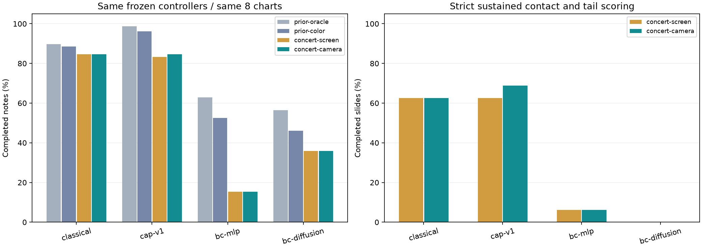

# Dual-arm control from the Drake camera's RGB image

This study replaces note-state input with RGB vision on the concert-style
(Project Sekai-inspired) display. It compares four **unchanged** controllers:
classical, the previous CAP v1, MLP BC, and diffusion BC. The same eight held-out
charts from the preceding study are used without training or test-driven tuning.

## Results

**21 tests passed.** The 64 test runs, four final warmups and two blackout
controls completed with zero execution errors and zero guarded-policy exceptions;
all **70 fingerprints** were verified. The two blackout runs produced zero
visual detections and completed **0/9** notes.

| Frozen controller | Previous color | Direct concert RGB | Drake camera RGB |
|---|---:|---:|---:|
| Classical | 69/78 (88.5%) | 66/78 (84.6%) | 66/78 (84.6%) |
| CAP v1 | 75/78 (96.2%) | 65/78 (83.3%) | 66/78 (84.6%) |
| BC MLP | 41/78 (52.6%) | 12/78 (15.4%) | 12/78 (15.4%) |
| BC diffusion | 36/78 (46.2%) | 28/78 (35.9%) | 28/78 (35.9%) |

The largest losses already appear with direct concert RGB, before adding the
camera path. This points to the changed display/detection inputs as the main
comparison issue; it does not isolate a specific detector or BC failure cause.
The one-slide gain for CAP with camera input is not evidence that cameras help.
This fixed-angle, calibrated pilot does not establish robustness to other poses,
lighting, latency or more severe occlusion.

Classical and CAP each complete 8/8 holds with camera input. Slide completion is
10/16 for classical, 11/16 for CAP, 1/16 for MLP and 0/16 for diffusion. Because
54 of the 78 notes are taps, [summary.md](summary.md) also reports equal-chart
averages and per-kind results. The old oracle numbers are shown there separately.



The preselected crossing-chart GIFs come from the actual scored camera runs:
[CAP v1: 2/3](cap-v1-camera.gif), [BC MLP: 0/3](bc-mlp-camera.gif).
CAP's first slide fails the tail check. There is no replacement with a better
replay. `media.json` links each GIF to its evaluation fingerprint and checksum.

## What reaches the controller

`Drake RgbdSensor RGB + dynamic display → RGB-only calibrated rectification →
color/shape detection → temporal note tracking → shared handoff router → two
independent arm policies → Drake dynamics → strict judge`.

The camera sees the scene in perspective at 960×720 with pixel noise (standard
deviation 3/255) and actual robot occlusion. Calibration uses known camera
intrinsics/extrinsics and screen geometry, then undoes the display's lane
contraction. It never fills occluded pixels from the clean screen. Tap/sustain
colors and the observed sustain path determine kind, lane, duration and timing.
Detections have no chart IDs. CAP and BC receive only those tracked visual
estimates and their own commanded hand state. This is calibrated classical
computer vision, not a learned encoder or VLM.

**Rendering boundary:** Drake renders the robot, screen slab and background.
The existing `CameraScreen` simulator paints the dynamic display into pixels
belonging to the visible screen, preserving occluding robot pixels. Render labels
are used only inside that environment renderer. The detector receives final RGB,
not labels, depth, clean texture, the chart, or measured robot poses. Thus this is
an occlusion-correct simulated camera composite, not a native animated Drake
material and not a physical camera experiment. The game renderer and judge
naturally retain the chart; neither passes it to the policy. `--view camera
--detector oracle` is now rejected explicitly.

## Paired comparison

There are 64 test simulations: four controllers × eight unchanged charts × two
inputs. `concert-screen` uses the direct concert RGB image; `concert-camera`
uses its camera observation. Their difference isolates the camera path, including
perspective resampling, noise and occlusion. Previous oracle/color results are
also shown, but previous color used a simpler calibrated display. Comparing it
directly with camera-concert therefore mixes display/vision and camera changes.

Programs, BC weights, tool geometry, timing windows and handoff rules are fixed.
Weights retain exactly the prior SHA-256 hashes. Two training charts are used for
vision development/warmup, never the eight test charts. The final detector,
configuration, runner and job list are frozen before any new test score is read.

Two additional full Drake runs use the nonempty training charts while replacing
**only the detector's RGB input with black pixels**. They test whether any note
information leaks around vision. Unit tests additionally check blank-image
behavior, pixel-dependent detection, preservation of blackout regions, unknown
note IDs, input dimensions, and rejection of oracle camera control.

See [summary.md](summary.md), [verification.json](verification.json) and
[comparison.png](comparison.png) for results. Completion requires the unchanged
strict sustain/gap/tail checks; low success is not an execution error. Results
are a small fixed-chart pilot, not evidence of generalization to real cameras.

## Reproduction and artifacts

GPU-host workspace: `/data/YifanKang/rhythmbot_camera_vision_v1`. All outputs,
temporary files and caches are under `/data/YifanKang`. Runs use four CPU workers,
one VTK/BLAS thread each, CPU policy inference, an 8 GB host RAM budget and
1 GB output budget. VTK/EGL rendering used GPU 0 (four graphics contexts at
111 MiB each; 1 GB VRAM budget), despite CUDA being disabled for inference.
This distinction was verified from actual graphics-process allocations. `preflight.json`, `tests.log` and the warmup reports record
validation. The software environment is the preceding study's Drake/PyTorch venv.

From that workspace:

```sh
bash scripts/run_camera_vision.sh warmup
bash scripts/run_camera_vision.sh negative
bash scripts/run_camera_vision.sh freeze
bash scripts/run_camera_vision.sh eval
PYTHONPATH=. python scripts/summarize_camera_vision.py
```

Freeze is one-time and evaluation rejects mismatched cached reports. Use a new
output directory for another configuration. For interactive single runs:

```sh
HEADLESS=1 python -m rhythmbot.play --stylus --no-realtime --view camera --detector concert \
  --policy cap:results/yifan-study-v1/cap/v1/policy.py \
  --chart results/yifan-study-v1/charts/test_iid/crossing-s31000-0.6s.json
```

The CLI example uses its default camera calibration; use the study runner for
the exact frozen 960×720 camera configuration in the table.

GIFs are recorded **during the evaluated camera runs**, on the preselected first
held-out crossing chart for CAP v1 and MLP BC. Left: the exact observed scene RGB;
right: the rectified pixels actually used by vision. The image timestamp is the
last perception tick, and the score overlay comes from the judge. There is no
separate ideal-screen inset. Full-resolution PNG sequences remain on gpu156.

Development attempts are retained separately. The first detector confused green
outlines with taps and split sustain heads at the judgment line; these were
corrected using training images. Its first recorded warmup also exposed a
floating-point end-time assertion in the capture loop, which was fixed before
the final warmup. Those attempts are not counted as passed evaluations.
