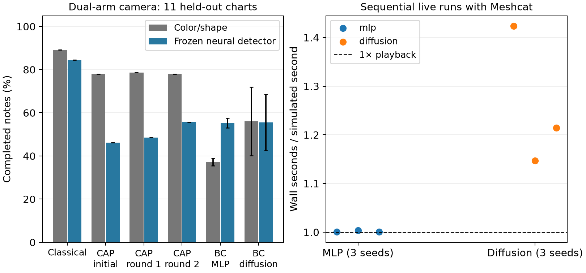

# Dual-arm neural-camera comparison and live BC evaluation

This study completes the remaining evaluations using two Drake iiwa arms, closed
WSG grippers and one stylus contact per arm. Both detectors receive the actual
Drake-composited RGB camera image, including robot occlusion. The game display
contains only lanes, notes and the judgment line. The physical model and strict
head/contact/tail judge are unchanged between paired methods.

## Protocol

`protocol.json`, `freeze.json` and `source-manifest.json` were written before the
full evaluation. The source package SHA-256 is
`47d41f138e25011233f0f7068c0b0a786f41859a3664236ae6f0dd06b5211eee`.
All chart and policy files are verified against the original
[`yifan-final-v1`](../yifan-final-v1/README.md) manifests. No new training or CAP
revision uses these test results.

- **Paired vision:** 220 runs = 11 held-out charts × 10 frozen controllers × two
  detectors. Camera resolution is 960×720. Runs are unpaced on gpu156, with four
  workers and no Meshcat. Their throughput is not real-time evidence.
- **Live BC:** 66 runs = the same 11 charts × six frozen BC checkpoints. Runs are
  sequential on the Apple M5 Mac, paced at 1×, with native Meshcat publishing
  and the 640×480 color/shape camera detector. Browser display latency is not
  measured. The neural-detector comparison is the separate full-resolution
  experiment above, not a claim of live neural throughput.
- **Controllers:** classical planning; Code as Policy (CAP) initial, feedback 1
  and feedback 2; multilayer-perceptron (MLP) behavior cloning (BC) with three
  training seeds; diffusion BC with three training seeds. CAP programs are the
  frozen Codex-generated programs. The raw file labels `cap-v0`, `cap-v1`, and
  `cap-v2` mean those successive training-feedback stages.
- **Inference:** CPU eager PyTorch, one Torch/BLAS thread per worker. Diffusion
  retains ten sampling steps and four-tick execution. Inference RNG seed is 0
  for every run, distinct from the three BC training seeds. This is not an
  evaluation across multiple diffusion sampling seeds.
- **Timing:** 1 ms physics, 30 Hz vision, 200 Hz judging. A strict real-time pass
  requires the maximum accumulated lag to remain within one 30 Hz frame
  (33.3 ms), not merely an average wall/simulation ratio near one. Startup is
  excluded from timing but recorded separately; browser rendering/network
  latency is outside this measurement.

## Frozen neural vision

`concert` is the color/shape detector. `concert-torch` is the frozen trained
note detector (`note_detector_v7.pt`, with active-slide-path prediction). It
receives only RGB and the simulation clock after the same calibrated geometric
warp. The network sees neither chart-derived note state, depth nor render
labels. Render labels are used internally by the environment to composite the
screen, not supplied to either detector.

This is **zero-shot transfer** from the network's original straight-lane display.
The current display differs in perspective, palette and occlusion. There is no
palette conversion, reconstructed clean frame, fine-tuning or held-out model
selection. The original neural model's strong single-arm results are therefore
not interchangeable with this dual-arm measurement.

The GPU host uses the existing eager-loading compatibility path because its
older PyTorch cannot import the newer TorchScript archive. The committed
`.state.pt` contains the original export's tensors, not a retrained model.
`transfer-probes/` and `scripts/verify_neural_backend.py` check tensor equality
and predictions against the original TorchScript implementation on fixed probe
images. All 62 tensors match exactly. Across 27 probe images, the largest cross-host
output difference is 3.44e-5 and all values pass the predeclared combined
absolute/relative tolerance of 2e-5; local eager and TorchScript outputs match
exactly on these probes. This is a bounded compatibility check, not a claim of
bitwise identity for arbitrary images. These probes are diagnostic controls,
excluded from the 286 task runs.

[`camera-snapshot/camera-rgb.png`](camera-snapshot/camera-rgb.png) and
[`camera-snapshot/network-input.png`](camera-snapshot/network-input.png) show the
actual sensor image and the warped network input at four seconds of a separate
neural-controlled rollout. Stylus occlusion remains visible in the network
input. The saved detections include spurious short holds along the green slide;
this is a concrete domain-transfer failure example, not a replacement task
score. The truncated illustration is excluded from accuracy and timing totals.

## Results and audit

<!-- VERIFIED RESULTS -->
**Verified: 220 paired-vision runs and 66 live BC runs; zero execution or CAP runtime errors.**

| Controller | Color/shape completion | Neural completion |
|---|---:|---:|
| Classical | 89.2% | 84.5% |
| CAP initial | 78.0% | 46.1% |
| CAP feedback 1 | 78.6% | 48.6% |
| CAP feedback 2 | 78.0% | 55.7% |
| MLP BC | 37.3 ± 1.8% | 55.3 ± 2.3% |
| Diffusion BC | 56.0 ± 15.9% | 55.6 ± 13.1% |

BC values are mean ± sample SD across three training seeds. All policies use the same 11 charts.

| Live controller | Completion (640×480) | Wall seconds / simulated second | One-frame lag passes | Worst accumulated lag |
|---|---:|---:|---:|---:|
| bc-mlp | 36.5% | 1.002 | 17/33 | 1.089 s |
| bc-diffusion | 55.6% | 1.262 | 0/33 | 19.832 s |


<!-- END VERIFIED RESULTS -->

Final values are generated from the raw reports into `summary.json`,
`summary.md`, `diagnostics.json`, and `overview.png`. The table aggregates note
completion within each policy/seed across all 11 charts; the plot shows the mean
and sample standard deviation across three BC training seeds. CAP has one
feedback chain, so its bars do not imply an estimate across independent agents.
Song excerpts contain more notes than synthetic charts; `diagnostics.json`
also reports chart-macro completion and chart-family counts.

`verification.json` checks all expected run identities, source and artifact
hashes, exact coverage, equal physical/camera configurations within each phase,
two arm instances, RGB-only observations, finalized notes, and absence of
execution or CAP runtime errors. A valid completed run may still miss notes or
fail the real-time criterion. Warmups are excluded from the results. All 61 unit tests passed on both the
local Mac and gpu156. The 220 transferred remote reports match their SHA-256
checksums in `remote-run-checksums.json`.

The live evaluation is complete, but reliable real-time execution is not:
MLP passes 17/33 chart runs, while diffusion passes 0/33 and averages 1.262 wall
seconds per simulated second. The neural detector improves MLP completion in
the full-resolution comparison, leaves diffusion's mean approximately unchanged,
and reduces classical/CAP completion. These are frozen zero-shot results;
training-only camera adaptation and latency optimization remain future work.

## Reproduce

Fetch the six original BC checkpoints from
`/data/YifanKang/rhythmbot_final_20261118/results/yifan-final-v1/checkpoints/`
on gpu156 into `results/yifan-final-v1/checkpoints/`; verify them against the
original `freeze.json`. They are deliberately excluded from Git. The small
neural detector and its compatibility state file are committed.

Use the frozen package source above. On gpu156 all code, caches, temporary files
and outputs must be under `/data/YifanKang/`. Check actual mounts, disk, RAM,
load and GPU headroom before launching. `resource-budget.txt` records the
preflight and four-worker budget; do not blindly reuse GPU indices on a busy
host. The study checkout is
`/data/YifanKang/rhythmbot_remaining_20261123/`.

```sh
python -m rhythmbot.remaining_study prepare --out results/remaining-study-v1
# gpu156: full-resolution paired accuracy, four workers
python -m rhythmbot.remaining_study compare --out results/remaining-study-v1 --workers 4
# Local Mac: sequential timing; do not run other local simulations concurrently
python -m rhythmbot.remaining_study live --out results/remaining-study-v1 --workers 1
# After gathering both phases into one directory
python -m rhythmbot.remaining_study verify --out results/remaining-study-v1
python -m rhythmbot.remaining_study summarize --out results/remaining-study-v1
python scripts/analyze_remaining_study.py results/remaining-study-v1
python scripts/plot_remaining_study.py results/remaining-study-v1
```

The runner resumes only completed reports with matching identities; errors
remain explicit rather than being silently omitted. Reproductions on different
machines or library versions may differ in timing or numerical behavior.
The unchanged full-song, real-camera, physical collision-avoidance and broader
sampling-seed questions are outside this registered study.
