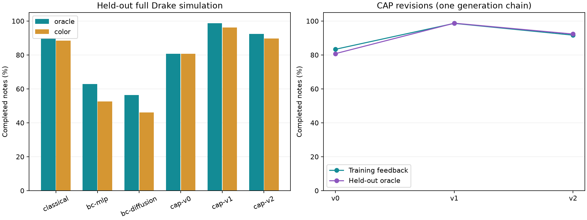

# Yifan's bimanual CAP / BC pilot

> Historical experiment: these scores and GIFs predate Anna's stricter touch-landing judge in `5c644a7`. They are not current-main benchmark results. See [the current handoff](../../docs/HANDOFF.md) for the unified environment and new validation.

This is the Agentic Code-as-Policy and Behavior Cloning work assigned to Yifan
in section 8 of the project proposal. It is separate from the preceding
classical-only 61-run benchmark. The two closed WSG grippers each carry one
central stylus, with actual two-iiwa Drake execution and strict slide contact,
gap and tail judgments.

## Observed results

All **132 simulations** completed (18 validation, 18 CAP feedback, 96 test),
with **zero execution errors and zero guarded-policy exceptions**. All 132
fingerprints match the frozen source, chart and policy/checkpoint identities.
The integration and slide-judgment suite passed **16 tests**.

Across all eight held-out charts (78 notes per policy/input):

| Policy | Oracle completion | Color completion | Oracle slides |
|---|---:|---:|---:|
| Classical | 70/78 (89.7%) | 69/78 (88.5%) | 14/16 |
| CAP v0 | 63/78 (80.8%) | 63/78 (80.8%) | 8/16 |
| CAP v1 | 77/78 (98.7%) | 75/78 (96.2%) | 15/16 |
| CAP v2 | 72/78 (92.3%) | 70/78 (89.7%) | 15/16 |
| BC MLP | 49/78 (62.8%) | 41/78 (52.6%) | 5/16 |
| BC diffusion | 44/78 (56.4%) | 36/78 (46.2%) | 0/16 |

CAP training feedback improves from 60/72 to 71/72, then falls to 66/72.
v1 is also strongest on held-out charts; v2 retains slide performance but
loses five taps. Extra feedback iterations did not monotonically improve this
chain. All revisions are reported rather than selecting one from test scores.

BC fits the command demonstrations but does not reproduce sustained slide
execution reliably. Both heads complete all eight oracle holds, while MLP
completes five of sixteen slides and diffusion completes none. With color input,
both BC heads complete zero slides. Observation shift and contact timing are
follow-up hypotheses, not isolated causes established by this pilot.

The note-weighted total is dominated by 54 taps. See [summary.md](summary.md)
for equal-chart averages, per-kind results and the faster-crossing split.
On the two faster charts, CAP v1/v2 complete 5/6 notes with either input;
MLP completes 2/6 with oracle and 0/6 with color, and diffusion completes 0/6.



The fixed first held-out crossing chart in the replays gives CAP v2 **3/3**
and MLP BC **1/3**. These are additional camera runs, outside the 132 quantitative
reports. The clips preserve the failures as well as successes:
[CAP v2 GIF](replays/cap-v2.gif), [MLP BC GIF](replays/bc-mlp.gif).

## Frozen protocol

- BC: 48 training charts, 6 whole-chart validation charts; 29,424 training
  observations and 3,588 validation observations. State MLP and state diffusion,
  30 epochs each, seed 0, checkpoint chosen by validation loss.
- Demonstrations are classical commanded targets collected through the common
  perception/brain/router, without robot dynamics during collection. Deployment
  is full Drake physics. They are not measured robot-state demonstrations.
- CAP: one initial valid program and two simulation-feedback revisions, generated
  by the external coding agent with tools disabled. Six training charts supply
  feedback. Exact prompts, responses, programs, cost/usage and hashes are saved
  under `cap/`. The initial generation was truncated and failed compilation;
  `cap/v0/attempt-0/` retains it. v0 is the compilation-repaired candidate before
  any physics feedback, so compilation repair is not a simulation-feedback gain.
- Held-out evaluation: six new-seed charts plus two faster crossing charts,
  all six policies, both oracle and calibrated color perception. Programs and
  weights are frozen before this evaluation. No test-driven policy selection.
- Every controller shares the existing handoff router and tool constraints.
  CAP/BC learn or generate local trajectories, not end-to-end arm assignment.
  The color detector reads calibrated rendered note frames, not a physical camera
  or the concert-style display texture.

This is a pilot with one training seed per BC head and one CAP generation chain.
It does not establish statistical superiority or generalization to real songs.
Touch is a geometric criterion; arm-to-arm collision avoidance is not validated.

## Reproduction

The GPU host workspace is `/data/YifanKang/rhythmbot_yifan_study_v1`.
All data, checkpoints, temporary files and caches remain under `/data/YifanKang`.
Use `preflight.json`, `gpu-warmup.json` and `tests.log` for resource and test evidence.
The eager PyTorch warmup exercises both heads on L40S without custom Triton kernels.

From the repository root, in a Drake/PyTorch environment:

```sh
python -m rhythmbot.yifan_study prepare --out results/yifan-study-v1
python -m rhythmbot.yifan_study collect --out results/yifan-study-v1 --workers 2
CUDA_VISIBLE_DEVICES=1 python -m rhythmbot.yifan_study fit --out results/yifan-study-v1 --head mlp --device cuda:0
CUDA_VISIBLE_DEVICES=1 python -m rhythmbot.yifan_study fit --out results/yifan-study-v1 --head diffusion --device cuda:0
```

`generate_stylus_cap.py` requires the authenticated Claude CLI. The CLI reports
its actual model in each saved metadata file; this run used `claude-opus-5-5`.
For each revision, evaluate only `--split feedback --detector oracle`, then pass
that revision's feedback and program to the generator. Never give it test reports.

Evaluation accepts matched lists of `--policy` and `--label`, e.g.
`--policy classical cap:/absolute/path/policy.py bc:/absolute/path/checkpoint.pt`.
Use `--split test --detector oracle color --workers 2` for the held-out suite.
Reports reject cached results when the source, chart, policy or job fingerprint
changes. Use a fresh output directory for changed code or protocol.

Weights and demonstration arrays are omitted from Git. `freeze.json` records
checkpoint paths and hashes on gpu156. Training metadata and full per-note
simulation reports are committed. Generate figures with:

```sh
python scripts/summarize_yifan_study.py results/yifan-study-v1
```

The exact GPU-host test launch is saved in `scripts/run_yifan_test.sh`;
`environment.json` records the package versions. For a new study, use a new
output directory. The original freeze is deliberately not replaceable.

Replay generation uses `scripts/render_yifan_comparison.sh`, with one render
process and bounded software-renderer threads. Both GIFs show the first held-out
crossing chart, selected before viewing its test scores. All physics frames
remain on gpu156; the GIFs and replay reports are committed.
